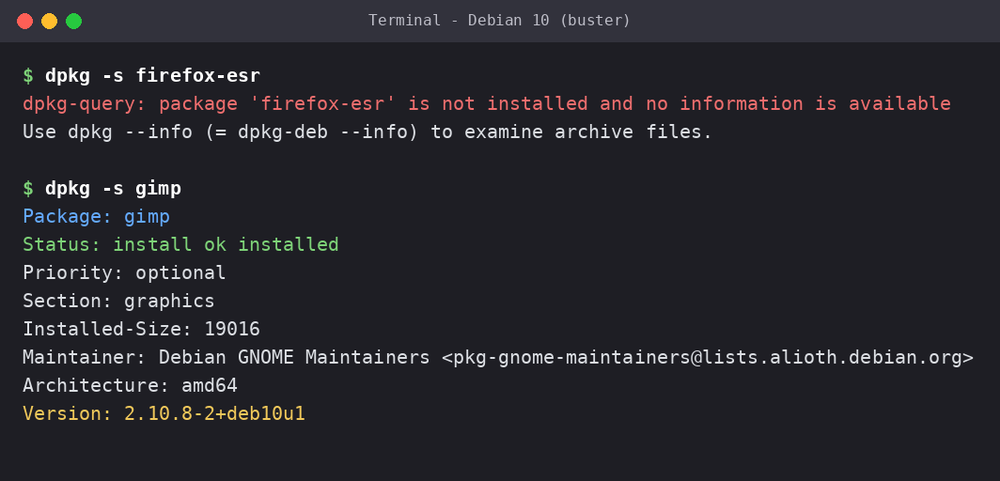
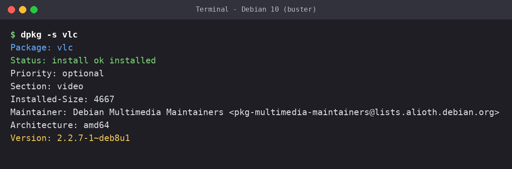
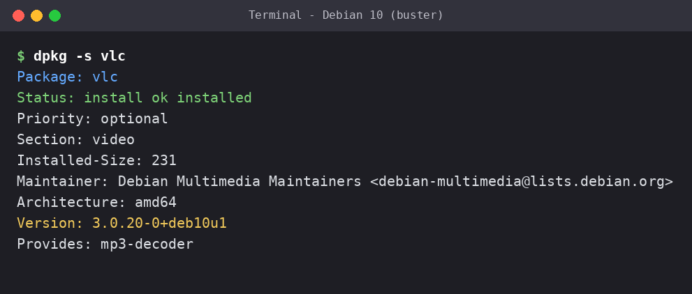
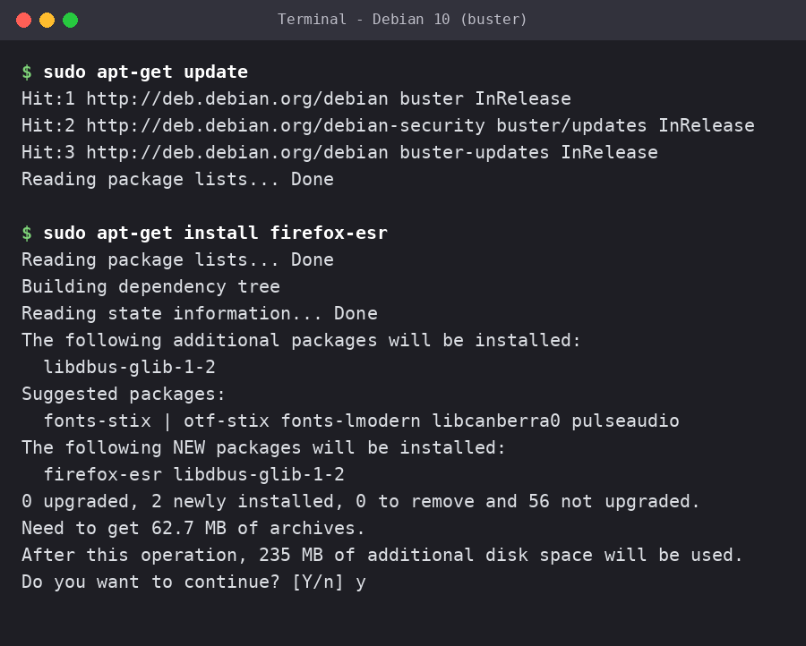
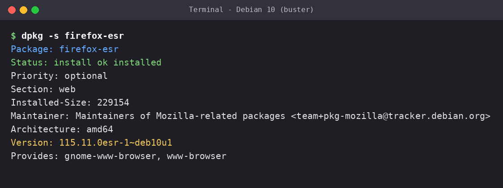
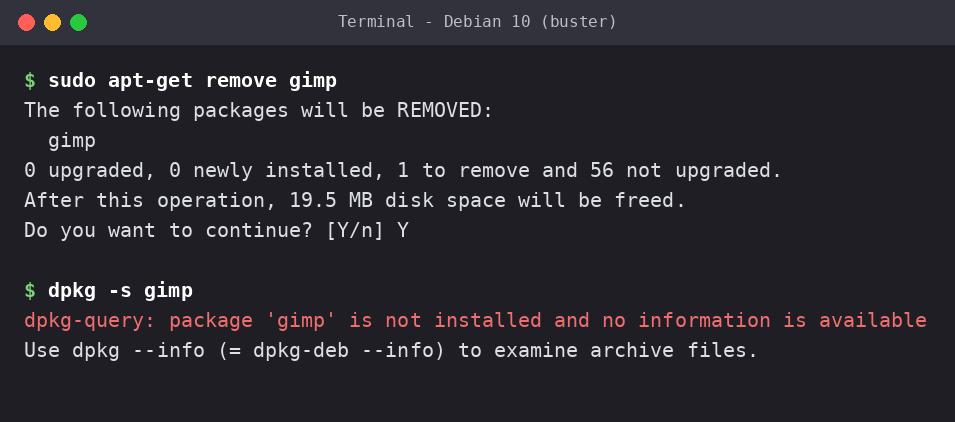

<div align="center">

# 🐧 Linux Package Management Lab

### Verify, Update, Install & Remove Software on Debian using `dpkg` and `apt-get`


</div>

---

## 📖 Overview

Managing software is a core skill for system administrators, IT support specialists, and security analysts. This hands-on lab covers the full lifecycle of a package on a Debian system:

**Check ➜ Update ➜ Install ➜ Verify ➜ Remove**

All outputs below were captured from a real Debian 10 (buster) lab instance.

## 🎯 Objectives

- ✅ Check whether a program is installed using `dpkg -s`
- ✅ Detect an outdated package (VLC) and update it
- ✅ Refresh repositories and install new software (Mozilla Firefox ESR)
- ✅ Uninstall software (GIMP)
- ✅ Verify every change by re-checking package status

## 🧰 Environment

| Item | Details |
|------|---------|
| OS | Debian 10 (buster), amd64 |
| Shell | Bash |
| Privileges | `sudo` for install, update, and remove |
| Packages | `firefox-esr`, `gimp`, `vlc` |

> ℹ️ Outputs are trimmed to the most relevant lines. `dpkg -s` only reads package status, so it needs no `sudo`.

> ⚠️ **Note on the OS version:** Debian 10 (buster) reached the end of its Long Term Support on June 30, 2024. This was a training lab environment, and Debian 10 is not a suitable choice for new or production systems today. The same commands work on current Debian and Ubuntu releases.

> 🔍 **Note on package versions:** All versions shown are exactly as they appeared in the lab. The VLC build string before the update (`2.2.7-1~deb8u1`) carries an older build suffix, likely from the lab image, while the repositories (`buster`) and the updated packages (`~deb10u1`) match Debian 10.

---

## 🔬 Lab Walkthrough

### 1️⃣ Check if a package is installed

`dpkg -s` (short for `--status`) reports the state of a package.

**Firefox ESR (not installed yet)**

```console
$ dpkg -s firefox-esr
dpkg-query: package 'firefox-esr' is not installed and no information is available
Use dpkg --info (= dpkg-deb --info) to examine archive files.
```

**GIMP (installed)**

```console
$ dpkg -s gimp
Package: gimp
Status: install ok installed
Priority: optional
Section: graphics
Installed-Size: 19016
Maintainer: Debian GNOME Maintainers <pkg-gnome-maintainers@lists.alioth.debian.org>
Architecture: amd64
Version: 2.10.8-2+deb10u1
```

🔎 **Key line:** `Status: install ok installed`

---

### 2️⃣ Spot an outdated package

**VLC before the update**

```console
$ dpkg -s vlc
Package: vlc
Status: install ok installed
Priority: optional
Section: video
Installed-Size: 4667
Maintainer: Debian Multimedia Maintainers <pkg-multimedia-maintainers@lists.alioth.debian.org>
Architecture: amd64
Version: 2.2.7-1~deb8u1
```

⚠️ VLC is installed, but the version is **2.2.7**, which is outdated. The lab target was **3.0.12 or higher**.

---

### 3️⃣ Update the package

Refresh the package lists, then install the newer version:

```bash
sudo apt-get update
sudo apt-get install vlc
```

> `apt-get update` only refreshes the list of available packages from the repositories. It does **not** install or upgrade any software. The `apt-get install vlc` command is what downloads and installs the newer VLC version.

Enter `y` when asked to continue, then verify:

```console
$ dpkg -s vlc
Package: vlc
Status: install ok installed
Priority: optional
Section: video
Installed-Size: 231
Maintainer: Debian Multimedia Maintainers <debian-multimedia@lists.debian.org>
Architecture: amd64
Version: 3.0.20-0+deb10u1
Provides: mp3-decoder
```

✅ Version moved from **2.2.7** ➜ **3.0.20**.

---

### 4️⃣ Install new software (Firefox ESR)

**Refresh repositories**

```console
$ sudo apt-get update
Hit:1 http://deb.debian.org/debian buster InRelease
Hit:2 http://deb.debian.org/debian-security buster/updates InRelease
Hit:3 http://deb.debian.org/debian buster-updates InRelease
Reading package lists... Done
```

**Install the package**

```console
$ sudo apt-get install firefox-esr
Reading package lists... Done
Building dependency tree
Reading state information... Done
The following additional packages will be installed:
  libdbus-glib-1-2
Suggested packages:
  fonts-stix | otf-stix fonts-lmodern libcanberra0 pulseaudio
The following NEW packages will be installed:
  firefox-esr libdbus-glib-1-2
0 upgraded, 2 newly installed, 0 to remove and 56 not upgraded.
Need to get 62.7 MB of archives.
After this operation, 235 MB of additional disk space will be used.
Do you want to continue? [Y/n] y
```

**Verify the installation**

```console
$ dpkg -s firefox-esr
Package: firefox-esr
Status: install ok installed
Priority: optional
Section: web
Installed-Size: 229154
Maintainer: Maintainers of Mozilla-related packages <team+pkg-mozilla@tracker.debian.org>
Architecture: amd64
Version: 115.11.0esr-1~deb10u1
Provides: gnome-www-browser, www-browser
```

✅ Status changed from *not installed* ➜ `install ok installed`.

---

### 5️⃣ Uninstall software (GIMP)

```console
$ sudo apt-get remove gimp
The following packages will be REMOVED:
  gimp
0 upgraded, 0 newly installed, 1 to remove and 56 not upgraded.
After this operation, 19.5 MB disk space will be freed.
Do you want to continue? [Y/n] Y
```

**Verify the removal**

```console
$ dpkg -s gimp
dpkg-query: package 'gimp' is not installed and no information is available
Use dpkg --info (= dpkg-deb --info) to examine archive files.
```

✅ GIMP is no longer installed.

> 💡 Some packages leave configuration files behind after `remove` and show `deinstall ok config-files`. Use `sudo apt-get purge <package>` to delete those as well.

---

## 📊 Results Summary

| Package | Before | Action | After |
|---------|--------|--------|-------|
| `firefox-esr` | Not installed | `apt-get install` | ✅ 115.11.0esr installed |
| `vlc` | 2.2.7 (outdated) | `apt-get update` + `install` | ✅ 3.0.20 |
| `gimp` | 2.10.8 installed | `apt-get remove` | ✅ Removed |

## ⚡ Command Cheat Sheet

| Task | Command |
|------|---------|
| Check package status | `dpkg -s <package>` |
| Refresh repository index | `sudo apt-get update` |
| Upgrade all packages | `sudo apt-get upgrade` |
| Install a package | `sudo apt-get install <package>` |
| Remove a package | `sudo apt-get remove <package>` |
| Remove package + config | `sudo apt-get purge <package>` |
| List installed packages | `dpkg -l` |

## 🧠 Key Takeaways

- `dpkg` inspects what is installed, while `apt-get` talks to repositories and resolves dependencies (Firefox pulled in `libdbus-glib-1-2` automatically).
- `apt-get update` refreshes the package lists only. Run it before installing so you get current versions, then use `apt-get install` or `apt-get upgrade` to actually change software.
- The install output reported **56 packages not upgraded**, a reminder that `apt-get upgrade` is needed to keep a system fully patched.
- Always verify a change after making it.

## 🔐 Security Relevance

| Practice | Why it matters |
|----------|----------------|
| Patching outdated software | Closes known vulnerabilities (VLC 2.2.7 ➜ 3.0.x) |
| Removing unused packages | Reduces the attack surface |
| Verifying installs and removals | Supports change control and system integrity |
| Using official repositories | Lowers supply-chain risk |

## 📸 Terminal Output

> Rendered from the command output captured during the lab session.

**1. Checking package status**


**2. Outdated VLC detected (2.2.7)**


**3. VLC after update (3.0.20)**


**4. Repository refresh and Firefox installation**


**5. Firefox verified as installed**


**6. Removing GIMP and verifying**


## 👩‍💻 Author

**Sameera**
Aspiring IT Support Professional | Cybersecurity

[](https://github.com/sameernazneen)

---

<div align="center">

⭐ If you found this helpful, consider starring the repo.

</div>
