# Active Directory: Users, Groups, Memberships & Group Policy (Windows Server)

Hands-on lab where I installed and configured **Active Directory Domain Services (AD DS)** on a Windows Server VM, created a user and a group, managed group memberships, and created a **Group Policy Object (GPO)** to set a desktop wallpaper.

## Objectives

- Install and configure Active Directory with PowerShell scripts
- Create a user account and understand why it starts **disabled**
- Reset a password and force a change at next logon
- Create a security group and nest it inside another group
- Add and remove members from groups
- Create and link a GPO to an Organizational Unit (OU)

## Environment

| Item | Details |
|------|---------|
| OS | Windows Server (Qwiklabs VM, accessed over RDP) |
| Domain | `example.com` |
| Tools | PowerShell, Active Directory Administrative Center (ADAC), Group Policy Management |
| Lab platform | Google IT Support Certificate / Qwiklabs |

---

## Part 1: Install and configure Active Directory

Open **Windows PowerShell as Administrator** (Start menu → right-click Windows PowerShell → More → Run as administrator).

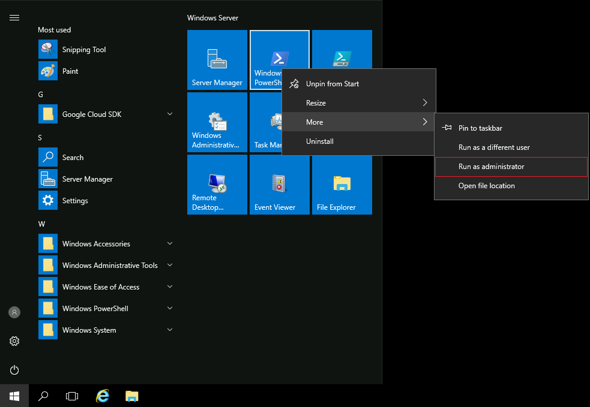

Run the installation script:

```powershell
C:\Qwiklabs\ADSetup\active_directory_install.ps1
```

The script prints some expected warnings, then the server restarts because AD DS was installed.


After the restart the RDP panel appears. I closed the tab and clicked **Open Windows VM** again to reconnect to the same VM (no need to re-run the install).

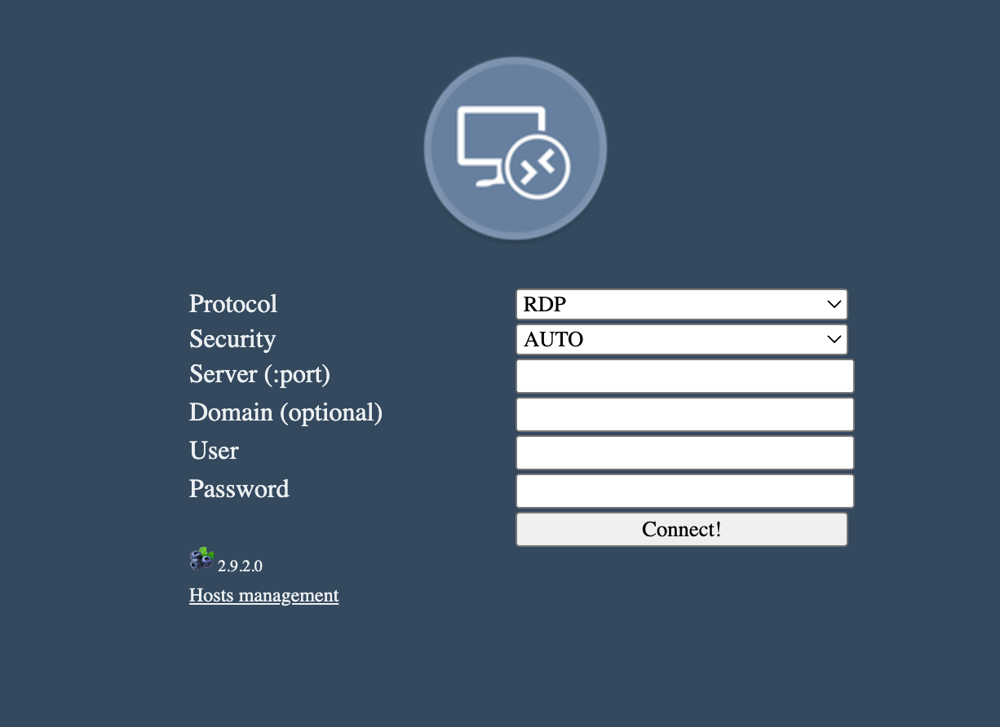

Then I opened PowerShell as Administrator again and ran the configuration script:

```powershell
C:\Qwiklabs\ADSetup\configure_active_directory.ps1
```

---

## Part 2: Manage users and groups

### Open Active Directory Administrative Center

Search for **active** in the Start menu and open *Active Directory Administrative Center*.

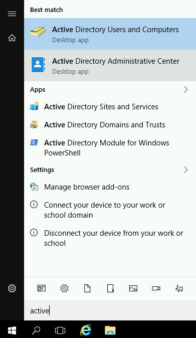

In ADAC I selected the `example (local)` domain and opened the **Users** container.

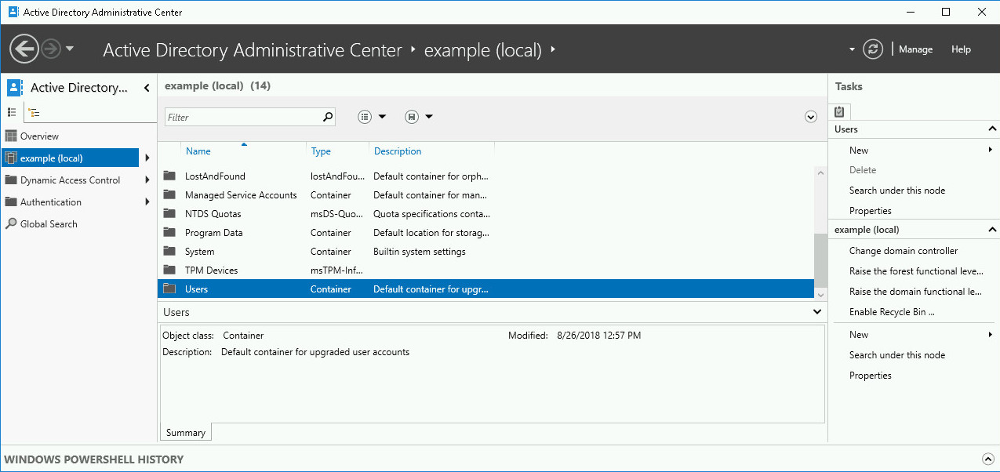

### Create the user Alex

Tasks pane → **Users → New → User**.

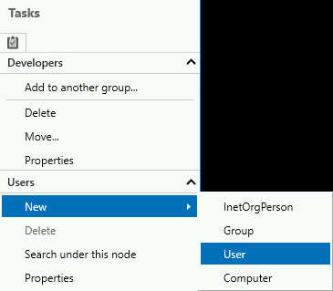

Filled in the mandatory fields: full name `Alex` and logon name `alex`.

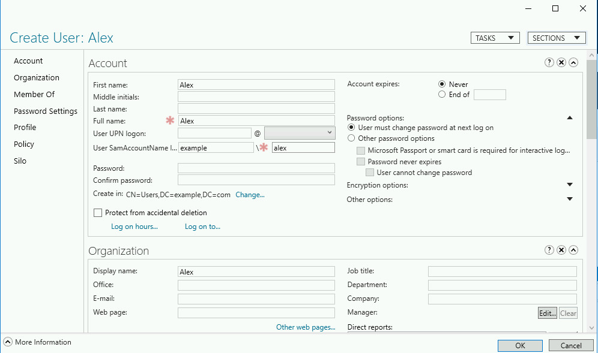

The new account shows as **Alex (Disabled)**. New accounts are created disabled until a valid password is set.

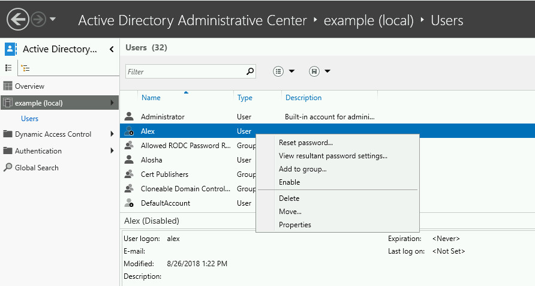

Trying to enable it without a password fails because it doesn't meet the domain's password requirements:

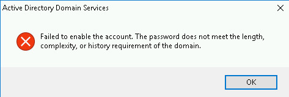

### Set a password and enable the account

Used **Reset password...** from the Tasks pane.

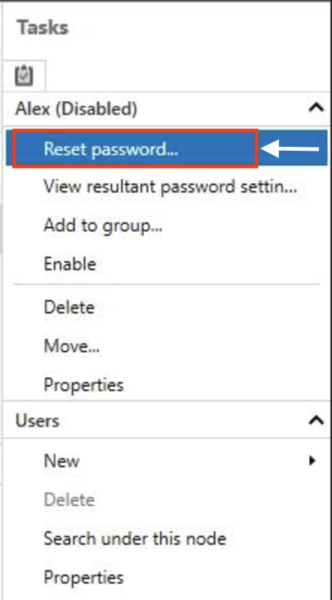

I left **User must change password at next log on** checked, so only the user knows their final password.

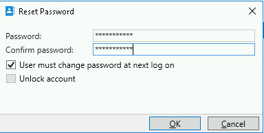

After setting a compliant password, enabling the account worked.

### Create the group Python Developers

Tasks pane → **Users → New → Group**.

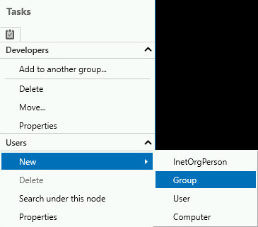

Group name: `Python Developers` (Security group, Global scope).

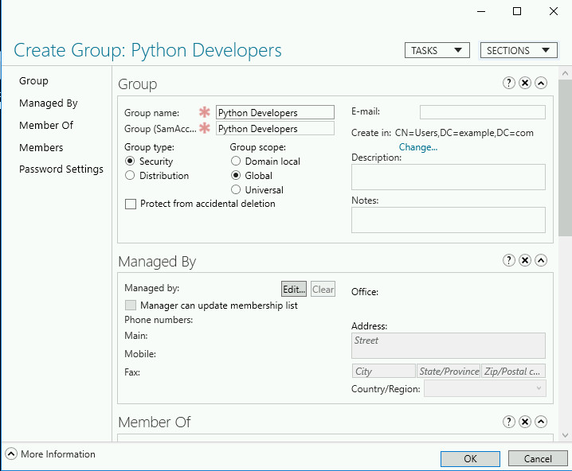

### Add Python Developers to the Developers group

Right-click the group → **Add to another group...**

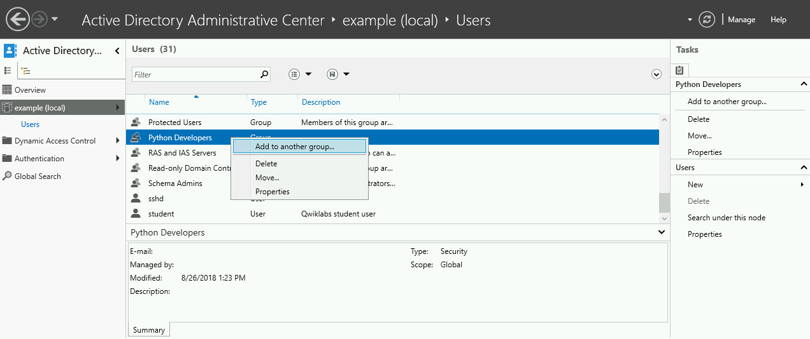

Entered `Developers` and confirmed.

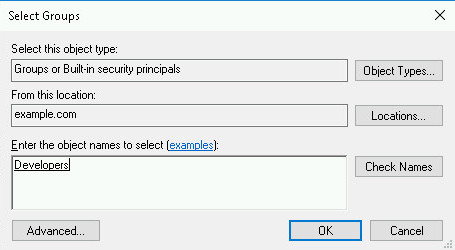

### Add Alex to Python Developers

Double-clicked **Python Developers** to open its properties, then went to **Members**.

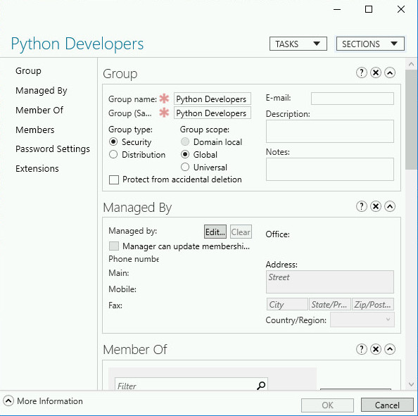

Clicked **Add**, entered `Alex`, and saved.

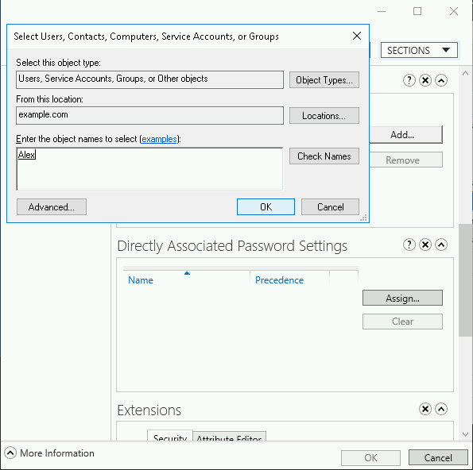

---

## Part 3: Edit memberships (Alosha moves from Java to Python)

Opened the properties of user **Alosha** → **Member Of**. Alosha belonged to *Domain Users* and *Java Developers*. I selected **Java Developers** and clicked **Remove**.

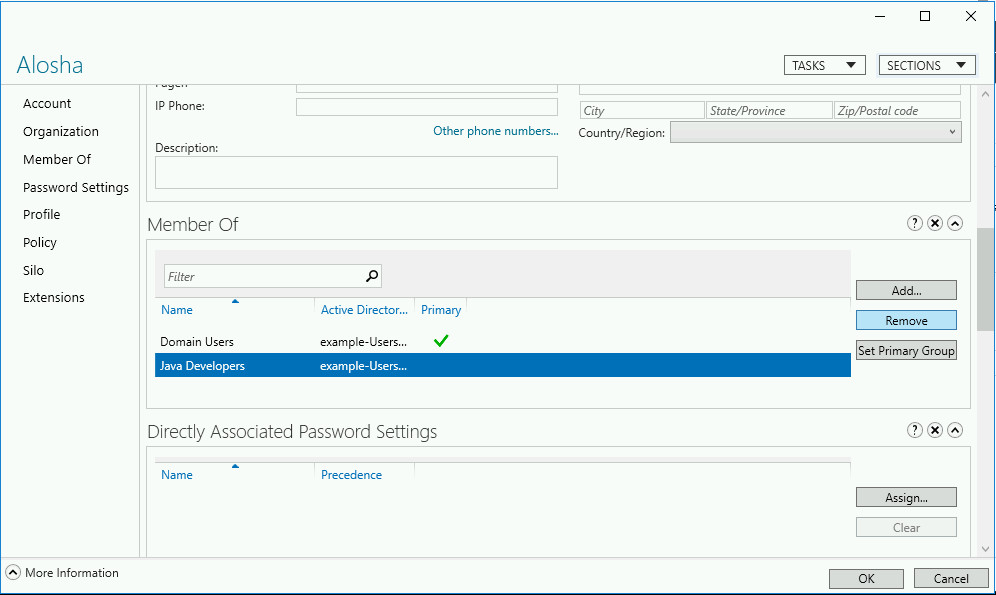

Then clicked **Add**, entered `Python Developers`, and confirmed with OK.

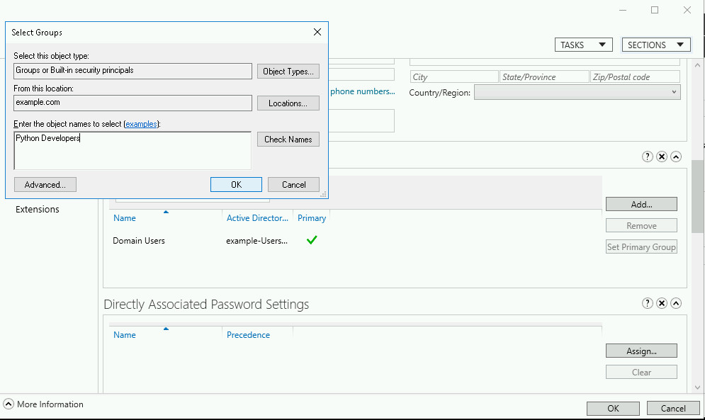

---

## Part 4: Group Policy (set a default wallpaper)

### Open Group Policy Management

Search for **group** in the Start menu and open *Group Policy Management*.

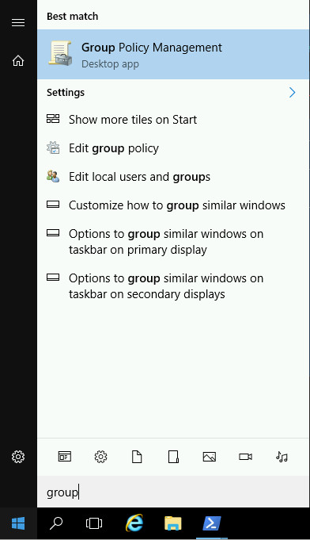

### Create a GPO and link it to the Developers OU

Expanded `example.com`, right-clicked the **Developers** OU, and chose **Create a GPO in this domain, and Link it here...**

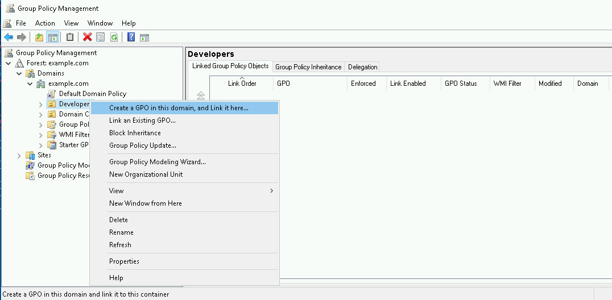

Named the policy `New Wallpaper`.

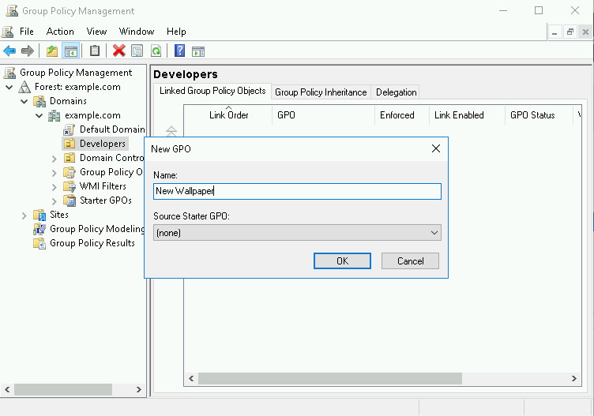

### Edit the policy

Right-clicked **New Wallpaper** → **Edit** (this opens the Group Policy Management Editor).

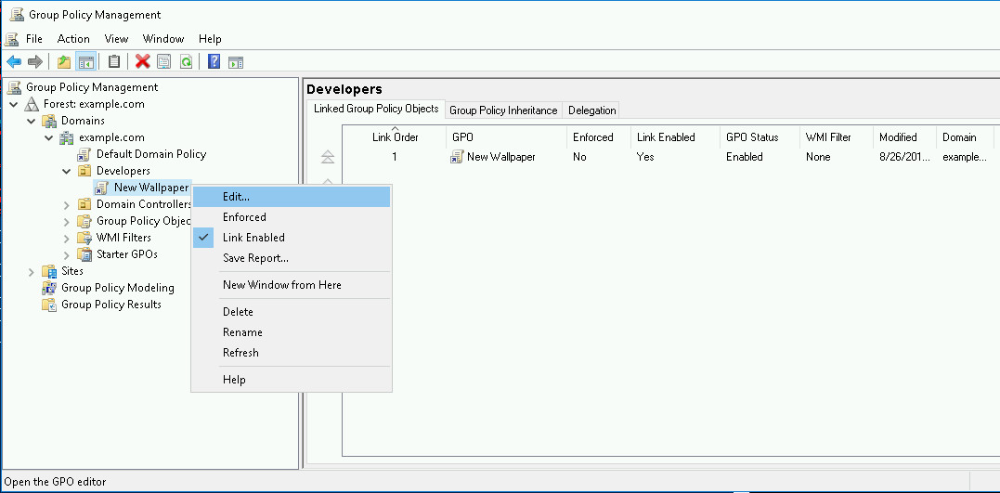

Navigated to:

`User Configuration > Policies > Administrative Templates > Desktop > Desktop`

and selected **Desktop Wallpaper**.

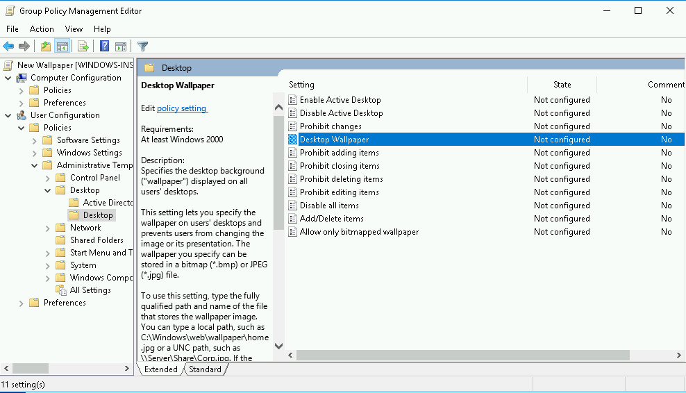

Set it to **Enabled** and entered the wallpaper path:

```
C:\Qwiklabs\wallpaper.jpg
```

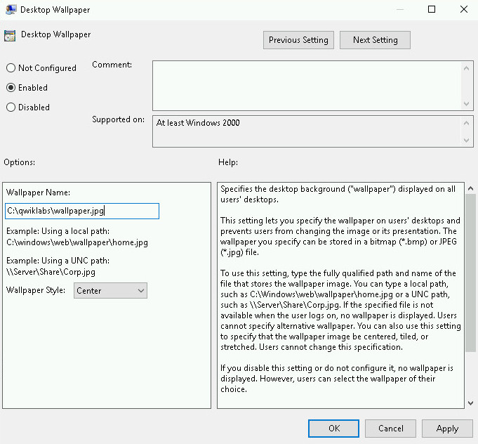

### Verify the policy

Back in Group Policy Management, the **Settings** tab of `New Wallpaper` shows Desktop Wallpaper as the only configured setting, set to `C:\Qwiklabs\wallpaper.jpg`.

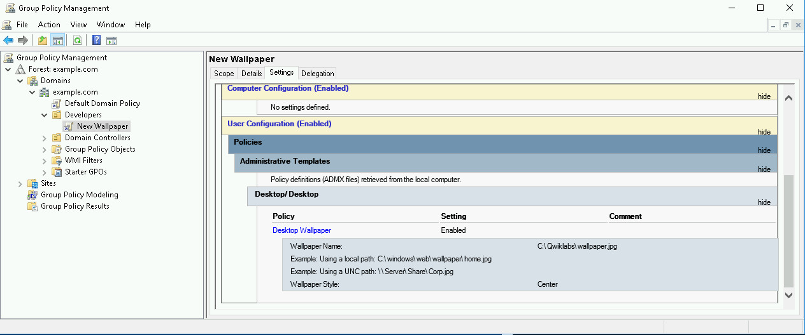

---

## Key Takeaways

- Active Directory centralizes management of users, groups, computers and policies
- New accounts are disabled until a password that meets the domain policy is set
- "User must change password at next log on" keeps the admin from knowing the user's final password
- Groups can be nested (Python Developers inside Developers), and memberships can be edited from either the group or the user
- GPOs linked to an OU apply settings to everything in that OU
- Group membership changes (Java → Python) are a common real-world admin task when someone changes roles

## Skills Demonstrated

Active Directory administration · User and group management · Password policy · Group membership management · Group Policy (GPO) · Windows Server · PowerShell · Technical documentation
