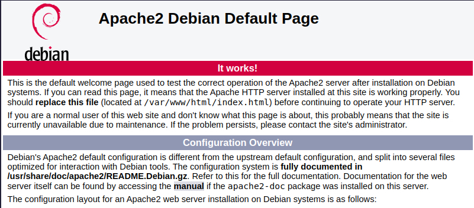
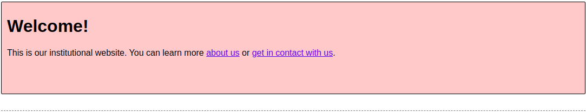
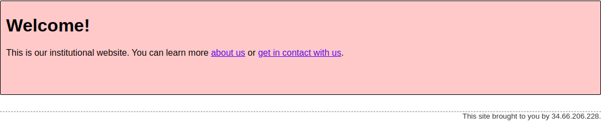

# Manage Websites with Apache2 (Debian/Linux)

Hands-on lab where I installed the **Apache2** web server, deployed a company website, switched Apache from the default site to a custom virtual host, and enabled **Server Side Includes (SSI)** so the page footer renders correctly.

## Objectives

- Install and start Apache2 on a Debian-based system
- Understand sites-available vs sites-enabled
- Create and enable a custom virtual host
- Enable and disable sites with `a2ensite` / `a2dissite`
- Enable Apache modules with `a2enmod`
- Configure Server Side Includes with `Options +Includes` and `XBitHack`

## Scenario

A web designer built an institutional website for the company (in `/opt/devel/ourcompany`). My task was to deploy it on a test instance, verify it works, and document the configuration so it can be repeated on production.

## Environment

| Item | Details |
|------|---------|
| OS | Debian-based Linux (Qwiklabs VM) |
| Web server | Apache2 |
| Site files | `/opt/devel/ourcompany` → `/var/www/ourcompany` |
| Lab platform | Google Cybersecurity Certificate / Qwiklabs |

---

## Step 1: Review the website files

```bash
ls -l /opt/devel/ourcompany
```

Files: `aboutus.html`, `contact.html`, `footer.html`, `index.html`, `style.css`

## Step 2: Install Apache2

```bash
sudo apt update
sudo apt install apache2
```

Check the status and start the service:

```bash
sudo service apache2 status
sudo service apache2 start
```

Browsing to the VM's external IP shows the default Apache2 Debian page, which confirms the server works.



## Step 3: Explore the site configuration

```bash
ls -l /etc/apache2/sites-available
cat /etc/apache2/sites-available/000-default.conf
```

- `000-default.conf` is the default HTTP site
- `default-ssl.conf` is the default HTTPS site

The core of the default config:

```apache
<VirtualHost *:80>
        ServerAdmin webmaster@localhost
        DocumentRoot /var/www/html
        ErrorLog ${APACHE_LOG_DIR}/error.log
        CustomLog ${APACHE_LOG_DIR}/access.log combined
</VirtualHost>
```

## Step 4: Move the website to `/var/www`

```bash
sudo mv /opt/devel/ourcompany /var/www/ourcompany
ls -l /var/www
```

## Step 5: Create a new site configuration

```bash
cd /etc/apache2/sites-available
sudo cp 000-default.conf 001-ourcompany.conf
sudo nano 001-ourcompany.conf
```

Changed the `DocumentRoot` line:

```apache
DocumentRoot /var/www/ourcompany
```

## Step 6: Enable the new site and disable the default

```bash
ls -l /etc/apache2/sites-enabled
sudo a2ensite 001-ourcompany.conf
sudo a2dissite 000-default.conf
ls -l /etc/apache2/sites-enabled
sudo service apache2 reload
```

Enabling a site simply creates a symbolic link from `sites-available` to `sites-enabled`:

```
001-ourcompany.conf -> ../sites-available/001-ourcompany.conf
```

The custom site is now live, but the footer is still empty:



## Step 7: Enable Server Side Includes (SSI)

`index.html` pulls in the footer using an SSI directive:

```html
<!--#include file="footer.html"-->
```

List available modules and enable `include`:

```bash
ls /etc/apache2/mods-available
sudo a2enmod include
sudo service apache2 restart
```

> A **restart** is required after enabling a module (a reload is not enough).

## Step 8: Allow SSI for the site

```bash
sudo nano /etc/apache2/sites-available/001-ourcompany.conf
```

Added after `DocumentRoot`:

```apache
<Directory /var/www/ourcompany>
        Options +Includes
        XBitHack on
</Directory>
```

- `Options +Includes` allows SSI in this directory
- `XBitHack on` processes files that have the executable bit set

Final configuration:

```apache
<VirtualHost *:80>
        ServerAdmin webmaster@localhost
        DocumentRoot /var/www/ourcompany

        <Directory /var/www/ourcompany>
                Options +Includes
                XBitHack on
        </Directory>

        ErrorLog ${APACHE_LOG_DIR}/error.log
        CustomLog ${APACHE_LOG_DIR}/access.log combined
</VirtualHost>
```

Reload Apache to apply the change:

```bash
sudo service apache2 reload
```

## Result

The website now loads with the footer rendered through Server Side Includes.



---

## Command Summary

| Command | Purpose |
|---------|---------|
| `sudo apt update` | Refresh package lists |
| `sudo apt install apache2` | Install Apache2 |
| `sudo service apache2 start/reload/restart` | Manage the service |
| `sudo mv` / `sudo cp` | Move site files and copy configs |
| `sudo nano` | Edit configuration files |
| `sudo a2ensite` / `a2dissite` | Enable / disable a site |
| `sudo a2enmod` / `a2dismod` | Enable / disable a module |

## Key Takeaways

- Sites live in `sites-available`, and are activated by symlinks in `sites-enabled`
- Config changes need a **reload**; new modules need a **restart**
- Website files belong in `/var/www/`
- A custom virtual host is the safe way to change what Apache serves, without editing the default site
- Always test on a staging instance before applying changes to production

## Skills Demonstrated

Linux administration · Apache2 web server management · Virtual hosts · Apache modules · Server Side Includes · Service management · Technical documentation
