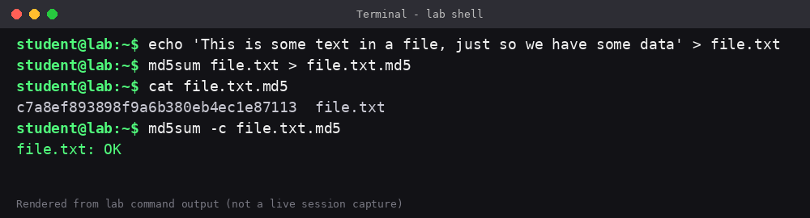
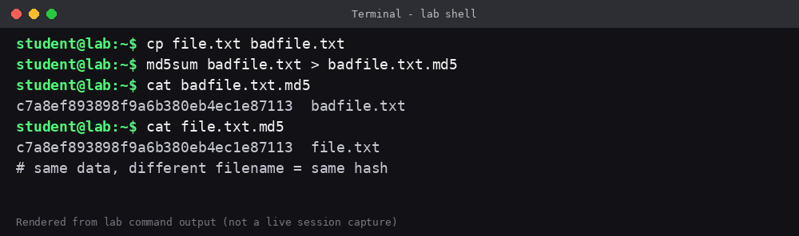
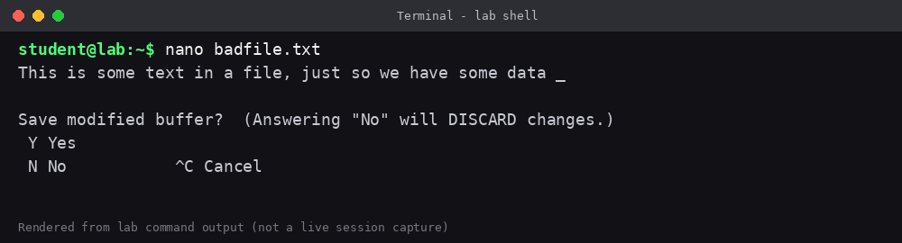
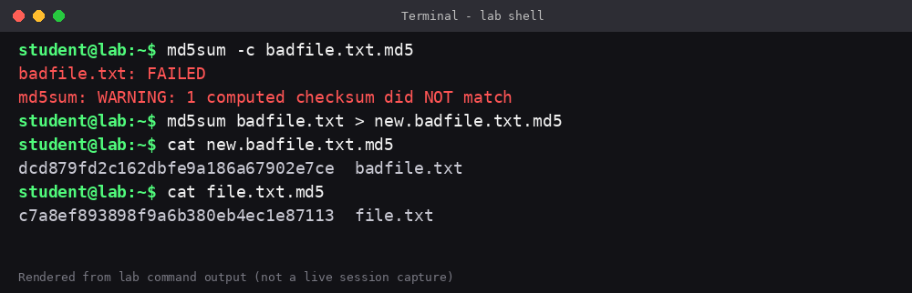
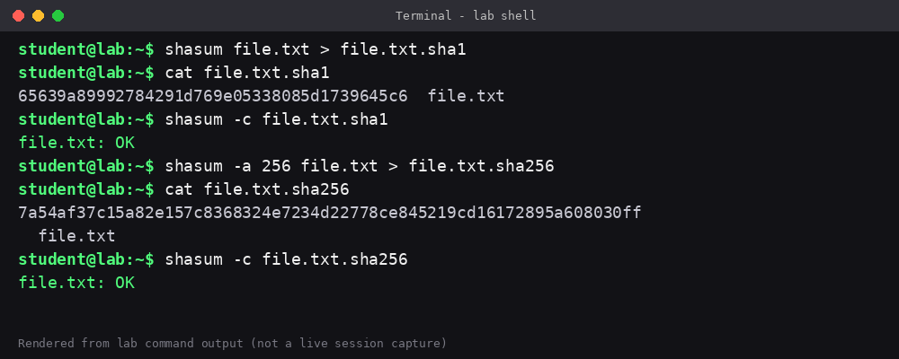

# Hashing and Integrity Verification with md5sum and shasum

Hands-on Linux lab (Qwiklabs, Google Cybersecurity Certificate) showing how hashes verify file integrity, and how even a one-character change breaks verification.

## Skills practiced
- Generating hashes with `md5sum` and `shasum` (SHA-1, SHA-256)
- Saving hashes to files and verifying with `-c`
- Detecting tampering: a single added space changes the whole digest
- Understanding that hashes cover file **data**, not file names

## Repository structure
```
.
├── README.md
├── scripts/hashing-lab.sh   # all commands in order
├── outputs/                 # terminal output for each step
└── screenshots/             # terminal-style images of each step
```

## Walkthrough

### 1. MD5: create and verify
```bash
echo 'This is some text in a file, just so we have some data' > file.txt
md5sum file.txt > file.txt.md5
cat file.txt.md5
md5sum -c file.txt.md5
```
```
c7a8ef893898f9a6b380eb4ec1e87113  file.txt
file.txt: OK
```

### 2.

 Same data, different name = same hash
```bash
cp file.txt badfile.txt
md5sum badfile.txt > badfile.txt.md5
cat badfile.txt.md5
```
```
c7a8ef893898f9a6b380eb4ec1e87113  badfile.txt
```
The hash matches `file.txt`, so the filename does not affect the hash.



### 3. Tamper with the file
Open `badfile.txt` in nano, add **one space** at the end of the line, save with `Ctrl+X`, `Y`, `Enter`.



```bash
nano badfile.txt
md5sum -c badfile.txt.md5
```
```
badfile.txt: FAILED
md5sum: WARNING: 1 computed checksum did NOT match
```

```bash
md5sum badfile.txt > new.badfile.txt.md5
cat new.badfile.txt.md5
```
```
dcd879fd2c162dbfe9a186a67902e7ce  badfile.txt
```
Compare with the original `c7a8ef893898f9a6b380eb4ec1e87113`: totally different, from a one-character change.



> Note: the exact new hash depends on exactly how the file is edited (for example, trailing newline). The values above are from the lab run.

### 4. SHA-1
```bash
shasum file.txt > file.txt.sha1
cat file.txt.sha1
shasum -c file.txt.sha1
```
```
65639a89992784291d769e05338085d1739645c6  file.txt
file.txt: OK
```

### 5. SHA-256
```bash
shasum -a 256 file.txt > file.txt.sha256
cat file.txt.sha256
shasum -c file.txt.sha256
```
```
7a54af37c15a82e157c8368324e7234d22778ce845219cd16172895a608030ff  file.txt
file.txt: OK
```



## Hash comparison

| Algorithm | Output length | Command | Status |
|---|---|---|---|
| MD5 | 128-bit (32 hex chars) | `md5sum` | Weak, collisions known; fine only for basic integrity checks |
| SHA-1 | 160-bit (40 hex chars) | `shasum` | Deprecated for security use |
| SHA-256 | 256-bit (64 hex chars) | `shasum -a 256` | Widely used today |

## Security takeaways
- **Integrity:** compare a published hash with the hash of a downloaded file to detect corruption or tampering.
- **Avalanche effect:** a tiny change gives a completely different digest.
- **Algorithm choice:** prefer SHA-256 over MD5 and SHA-1 for security-sensitive work.
- **Limits:** a hash alone does not prove who created the file; for that you need digital signatures.

## About the screenshots
Images in `screenshots/` are rendered from the lab's command output, not live session captures.

## Disclaimer
Educational lab notes, run in a disposable lab environment.
