# Managing File and Folder Permissions in Linux with chmod and chown

A hands-on lab write-up covering how to **check, change, and reassign** permissions and ownership of files and folders on a Linux machine using `ls`, `chmod`, and `chown`.

> **Skills demonstrated:** Linux file permissions, symbolic and numeric `chmod`, ownership with `chown`, least-privilege access, verifying changes from the Bash shell.

---

## Table of Contents

1. [Scenario](#scenario)
2. [Lab Setup](#lab-setup)
3. [Permissions Quick Reference](#permissions-quick-reference)
4. [Task 1: Check and change file permissions](#task-1-check-and-change-file-permissions)
5. [Task 2: Change folder permissions](#task-2-change-folder-permissions)
6. [Task 3: Change the owner of a folder](#task-3-change-the-owner-of-a-folder)
7. [Task 4: Practice with more files](#task-4-practice-with-more-files)
8. [Key Takeaways](#key-takeaways)

---

## Scenario

This lab has two main goals:

- Get comfortable changing permissions on files and folders in Linux
- Change the ownership of a specific file and folder

## Lab Setup

I started the lab and worked in the Bash shell it provides.

> **Note on screenshots:** The images in `screenshots/` are terminal-style renderings of the exact commands and output from this lab. Replace them with your own captures from the lab shell if you want original screenshots.

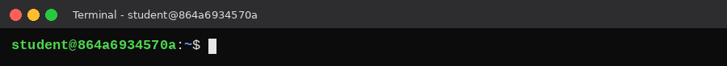

**Working paths used in this lab**

| Item | Path |
|------|------|
| Important file | `/home/qwiklab/documents/important_document` |
| Less important file | `/home/qwiklab/documents/not_so_important_document` |
| Public file | `/home/qwiklab/documents/public_document` |
| Secret folder | `/home/qwiklab/secret_folder/` |
| Taco folder | `/home/qwiklab/taco/` |

## Permissions Quick Reference

**Reading `ls -l` output**

```text
-rwxrw-r--  1 student student 20 Aug  4 11:38 not_so_important_document
│└┬┘└┬┘└┬┘
│ │  │  └── other (everyone else)
│ │  └───── group
│ └──────── owner (user)
└────────── type: - file, d directory
```

**Permission values**

| Letter | Meaning | Number |
|--------|---------|--------|
| `r` | Read | 4 |
| `w` | Write | 2 |
| `x` | Execute | 1 |

Add the numbers for each class (owner, group, other). For example, `rwx` = 7, `rw-` = 6, `r--` = 4, `---` = 0.

**Symbolic `chmod` letters**

| Who | Letter | Operator | Meaning |
|-----|--------|----------|---------|
| User (owner) | `u` | `+` | add a permission |
| Group | `g` | `-` | remove a permission |
| Other | `o` | `=` | set exactly |
| All | `a` | | |

---

## Task 1: Check and change file permissions

**Goal:** `important_document` should let the **owner** read, write, and execute, and give everyone else nothing.

**Step 1: Move to the documents directory and check the current permissions**

```bash
cd ../qwiklab/documents
ls -l important_document
```

```text
-rw------- 1 student student 16 Aug  4 11:38 important_document
```

The owner can read and write; the group and others have no access.

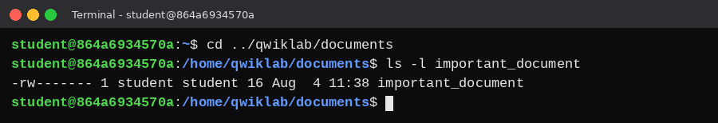

**Step 2: Add execute for the owner using the numeric mode**

`700` gives the owner all permissions (7) and the group and others none (0, 0).

```bash
sudo chmod 700 important_document
ls -l important_document
```

```text
-rwx------ 1 student student 16 Aug  4 11:38 important_document
```

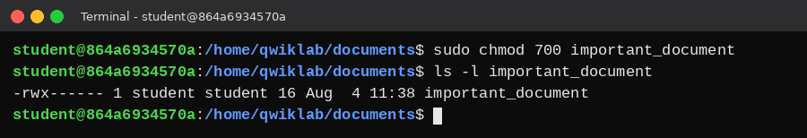

**Result:** The owner now has read, write, and execute. No one else has access.

---

## Task 2: Change folder permissions

**Goal for `/home/qwiklab/secret_folder/`:**

- The owner has all permissions
- The group has only write permission
- Everyone else has no permissions

> **Heads-up:** `chmod` on a directory does not change the files inside it.

**Step 1: Move up one directory and view the folder's permissions**

Use `-ld` instead of `-l` so `ls` shows the folder itself, not its contents.

```bash
cd ..
ls -ld secret_folder/
```

```text
drw-r--r-- 2 root root 4096 Aug  4 11:38 secret_folder/
```

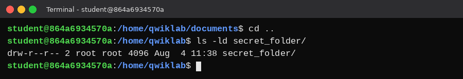

**Step 2: Give the owner execute permission** (`u` = user, `x` = execute)

```bash
sudo chmod u+x secret_folder/
ls -ld secret_folder/
```

```text
drwxr--r-- 2 root root 4096 Aug  4 11:38 secret_folder/
```

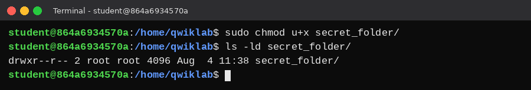

**Step 3: Give the group write and remove its read** (`g` = group)

```bash
sudo chmod g+w secret_folder/
sudo chmod g-r secret_folder/
ls -ld secret_folder/
```

```text
drwx-w-r-- 2 root root 4096 Aug  4 11:38 secret_folder/
```

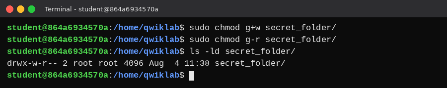

**Step 4: Remove read from everyone else** (`o` = other)

```bash
sudo chmod o-r secret_folder/
ls -ld secret_folder/
```

```text
drwx-w---- 2 root root 4096 Aug  4 11:38 secret_folder/
```

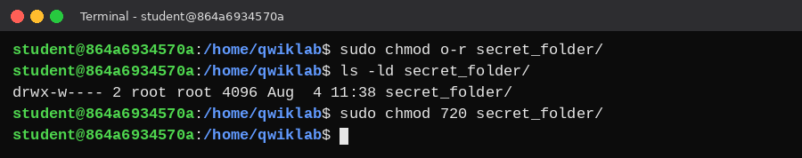

**Numeric shortcut:** the same final result in one command.

```bash
sudo chmod 720 secret_folder/
```

**Result:** Owner `rwx`, group `-w-`, others `---`.

---

## Task 3: Change the owner of a folder

**Goal:** Make the user `cook` the owner of `/home/qwiklab/taco/`.

**Step 1: Check the current owner**

```bash
ls -ld taco/
```

```text
drwxr-xr-x 2 root root 4096 Aug  4 11:38 taco/
```

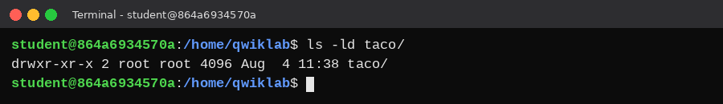

**Step 2: Change the owner with `chown` and verify**

```bash
sudo chown cook /home/qwiklab/taco
ls -ld taco/
```

```text
drwxr-xr-x 2 cook root 4096 Aug  4 11:38 taco/
```

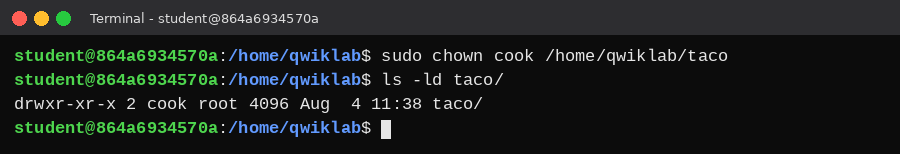

**Result:** `cook` is now the owner. The group is still `root`.

---

## Task 4: Practice with more files

### `not_so_important_document`

**Goal:**

- The owner has all permissions
- The group has read and write
- Everyone else has read

**Step 1: View the current permissions**

```bash
cd documents
ls -l not_so_important_document
```

```text
-rw-r----- 1 student student 20 Aug  4 11:38 not_so_important_document
```

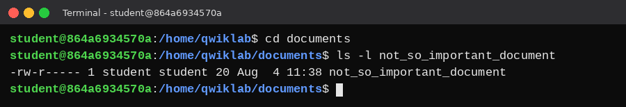

**Step 2: Add execute for the owner and write for the group**

```bash
sudo chmod u+x not_so_important_document
ls -l not_so_important_document
sudo chmod g+w not_so_important_document
ls -l not_so_important_document
```

```text
-rwxr----- 1 student student 20 Aug  4 11:38 not_so_important_document
-rwxrw---- 1 student student 20 Aug  4 11:38 not_so_important_document
```

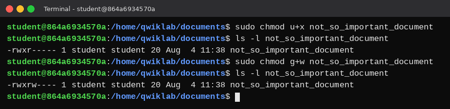

**Step 3: Add read for others**

`a+r` adds read for everyone (owner, group, other). The owner and group already have read, so only "others" actually change. `o+r` would give the same result.

```bash
sudo chmod a+r not_so_important_document
ls -l not_so_important_document
```

```text
-rwxrw-r-- 1 student student 20 Aug  4 11:38 not_so_important_document
```

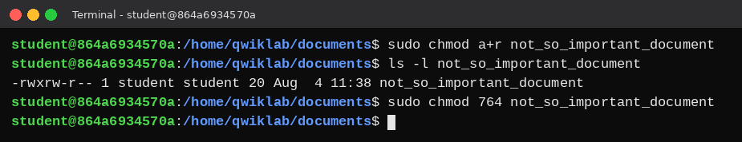

**Numeric shortcut:**

```bash
sudo chmod 764 not_so_important_document
```

### `public_document`

**Goal:** Everyone has read, write, and execute.

**Step 1: View the current permissions**

```bash
ls -l public_document
```

```text
-rw-r--r-- 1 student student 14 Aug  4 11:38 public_document
```

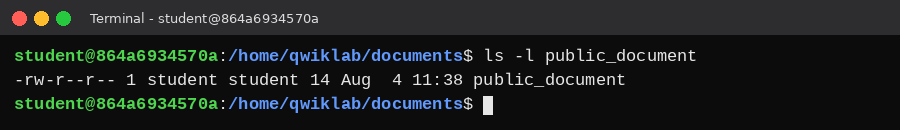

**Step 2: Add all three permissions for everyone at once**

```bash
sudo chmod a+rwx public_document
ls -l public_document
```

```text
-rwxrwxrwx 1 student student 14 Aug  4 11:38 public_document
```

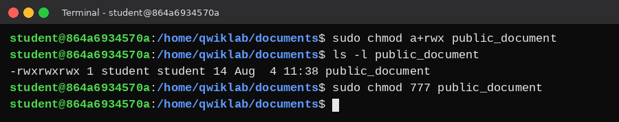

**Numeric shortcut:**

```bash
sudo chmod 777 public_document
```

**Result:** Every user has full permissions on `public_document`. In real systems this is rarely appropriate; it is used here only for practice.

---

## Key Takeaways

- **Check first, then change.** Use `ls -l` for files and `ls -ld` for directories before and after every change.
- **Two ways to use `chmod`.** Symbolic (`u+x`, `g-r`, `o+r`, `a+rwx`) changes one thing at a time; numeric (`700`, `720`, `764`, `777`) sets everything at once.
- **Know the numbers.** `r`=4, `w`=2, `x`=1, added per class (owner, group, other).
- **`chown` changes the owner, `chmod` changes the access.** They are separate controls.
- **Directories are special.** `chmod` on a folder does not change the files inside it.
- **Least privilege.** Give only the access that is needed; `777` is almost never a good idea in production.

---

*Lab completed as part of the Google Cybersecurity Professional Certificate (Qwiklabs Linux shell).*
