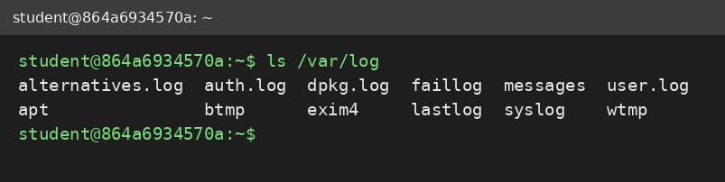
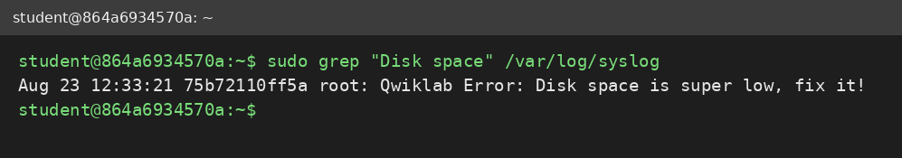
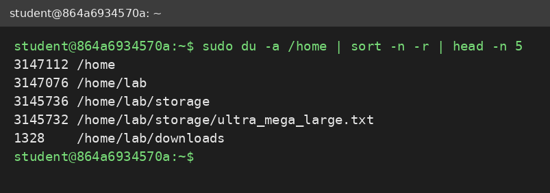
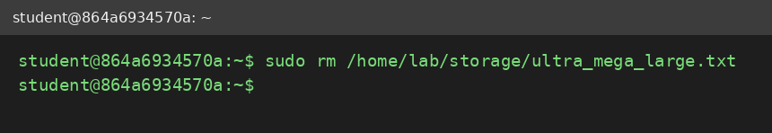

# Using Logs to Track Down Issues on Linux

Write-up of the hands-on lab *"Using logs to help you track down an issue in Linux"* (Google IT Support course, Coursera). The lab presents a Linux VM with several problems. The only clues are entries in the system log, so the job is to read the log, find the cause, and fix it.

---

## Repository Structure

```
linux-log-troubleshooting/
├── README.md
└── screenshots/
    ├── 01-ls-var-log.png
    ├── 02-syslog-disk-space-entry.png
    ├── 03-du-sort-head-largest-files.png
    └── 04-rm-large-file.png
```

---

## 1. Approach

**Detect → Locate → Fix → Verify → Document**

Logs say *what* is wrong but often not *where*, so each ticket needs a short investigation before the fix.

## 2. Step 1: Find the Logs

On Linux, logs live in `/var/log`.

```bash
ls /var/log
```

*Figure 1: log files in `/var/log`. `syslog` holds the general system messages.*

View the system log (it is long, so scroll or filter it):
```bash
sudo cat /var/log/syslog
```
Filter for the lab's error entries instead of scrolling:
```bash
sudo grep "Qwiklab Error" /var/log/syslog
```

---

## 3. Issue 1: Low Disk Space

**Log entry:**
```
Aug 23 12:33:21 75b72110ff5a root: Qwiklab Error: Disk space is super low, fix it!
```

*Figure 2: the log says disk space is low but does not name the file.*

### Locate the cause: find the largest files
```bash
sudo du -a /home | sort -n -r | head -n 5
```

| Part | Purpose |
|---|---|
| `du -a /home` | list the size of every file and folder under `/home` |
| `sort -n -r` | sort numerically, largest first |
| `head -n 5` | show only the top 5 results |


*Figure 3: `ultra_mega_large.txt` under `/home/lab/storage` is the largest file. The folders above it are larger only because they contain it.*

### Fix: delete the file
```bash
sudo rm /home/lab/storage/ultra_mega_large.txt
```

*Figure 4: the large file is removed.*

> The log entry stays in `syslog` after the fix. Logs are a history, so verification means re-checking the system, not the log.

---

## 4. Other Issues in the Lab

The remaining log entries were resolved with the same investigate-then-fix pattern, using these standard tools:

| Type of issue | Commands |
|---|---|
| Outdated software | `sudo apt update` then `sudo apt install --only-upgrade <package>` |
| Unwanted or corrupted file | `find / -name "<filename>" 2>/dev/null` then `sudo rm <path>` |
| Wrong file permissions | `ls -l <file>` then `sudo chmod <mode> <file>` |
| Wrong ownership | `sudo chown <user>:<group> <file>` |
| Suspicious process | `ps -aux \| grep "<name>"` then `sudo kill <PID>` |

---

## 5. Key Takeaways

- Start with the log: **when** it happened and **what** it says narrows the search.
- `grep` turns a long log into the few lines that matter.
- `du | sort | head` is a fast way to find what is eating disk space.
- Always check what a file is before deleting it, because deletion with `rm` is permanent.
- Verify after every fix.

## 6. Skills Demonstrated

Linux log analysis · `/var/log` · `grep` · `du` · `sort` · `head` · `rm` · `chmod` / `chown` · `ps` / `kill` · troubleshooting workflow

**Credential link:** `<add your Coursera certificate or profile URL here>`
