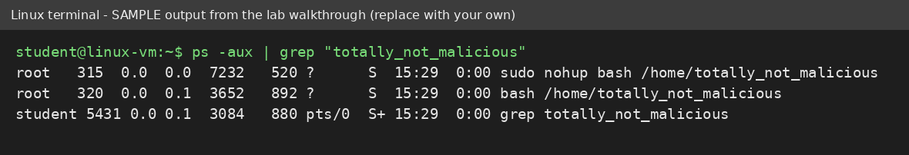
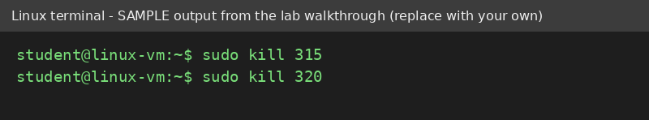
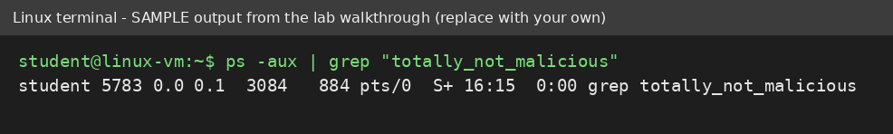
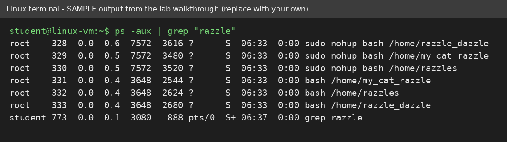
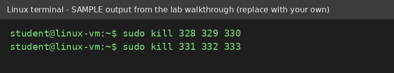
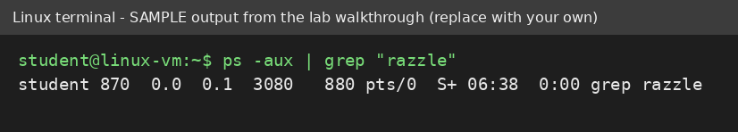

# Maintain Efficient Process Utilization on Linux

Write-up of the hands-on lab on process maintenance in a Linux VM (Google IT Support course, Coursera). It covers listing processes, filtering them with `grep`, and terminating unwanted ones with `kill`.

> **About the images:** the images in `screenshots/` are terminal renderings of the lab walkthrough's sample output (they say so in their title bar). Replace each file with a screenshot from your own run, keeping the same filename.

---

## Repository Structure

```
linux-process-management/
├── README.md
└── screenshots/
    ├── 01-ps-grep-totally-not-malicious.png
    ├── 02-kill-totally-not-malicious.png
    ├── 03-verify-totally-not-malicious-gone.png
    ├── 04-ps-grep-razzle.png
    ├── 05-kill-razzle-processes.png
    └── 06-verify-razzle-gone.png
```

---

## 1. Why This Matters

Every running program is a **process**. Unwanted or runaway processes waste CPU and memory and can be a sign of malware. A support or SOC analyst needs to find a process, identify it by its PID, stop it, and confirm it is gone.

**Workflow:** list, filter, terminate, verify.

## 2. Commands Used

| Command | Purpose |
|---|---|
| `ps -aux` | List all running processes (`a` all users, `u` user-oriented format, `x` include processes without a terminal) |
| `grep "<text>"` | Filter output to lines containing the text |
| `sudo kill <PID>` | Ask a process to stop (sends SIGTERM); `sudo` is needed for processes owned by root |
| `kill -9 <PID>` | Force-stop a process that ignores a normal `kill` (SIGKILL) |

---

## 3. Task A: Terminate a Specific Process

**Scenario:** processes named `totally_not_malicious` were running.

### Step 1: Find them
```bash
ps -aux | grep "totally_not_malicious"
```
The **second column** is the PID. One line in the results is always the `grep` command itself, so ignore it.


*Figure 1: matching processes with their PIDs.*

My output:
```
<paste your terminal output here>
```

### Step 2: Terminate each one
```bash
sudo kill <PID>
```

*Figure 2: terminating each process by PID.*

### Step 3: Verify
```bash
ps -aux | grep "totally_not_malicious"
```
Only the `grep` line should remain.


*Figure 3: only the grep process is left, so the targets are gone.*

My output:
```
<paste your terminal output here>
```

---

## 4. Task B: Terminate Multiple Processes

**Scenario:** several processes contained the word `razzle` in their names. `grep` matches substrings, so one search finds them all (each program appeared twice: a `sudo nohup bash` wrapper and the `bash` script itself).

### Step 1: Find them
```bash
ps -aux | grep "razzle"
```

*Figure 4: all processes containing "razzle", each with its own PID.*

My output:
```
<paste your terminal output here>
```

### Step 2: Terminate each PID
```bash
sudo kill <PID>
```
Repeat for every PID listed (or pass several: `sudo kill <PID1> <PID2> <PID3>`).


*Figure 5: terminating each razzle process.*

### Step 3: Verify
```bash
ps -aux | grep "razzle"
```

*Figure 6: only the grep line remains.*

My output:
```
<paste your terminal output here>
```

---

## 5. Key Takeaways

- Read the **PID from the `ps` output** each time. PIDs change every session.
- `grep` matches partial text, so one search can find a whole family of processes.
- The `grep` line in the results is the search itself, not a target.
- **Verify** after killing by running the same search again.
- In a real incident, check what a process is (path, owner, parent) before killing it, since it may be evidence or a critical service.

## 6. Skills Demonstrated

Linux process management · `ps` · `grep` · piping · `kill` · `sudo` · troubleshooting workflow · verification

**Credential link:** `<add your Coursera certificate or profile URL here>`
