# Managing File and Folder Permissions in Windows with ICACLS (PowerShell)

A hands-on lab write-up covering how to **view, grant, modify, and remove** file and folder permissions on Windows using the `ICACLS` command in PowerShell.

> **Skills demonstrated:** Windows access control, least-privilege permissions, user vs. group permissions, PowerShell CLI, verifying changes after configuration.

---

## Table of Contents

1. [Scenario](#scenario)
2. [Lab Setup](#lab-setup)
3. [ICACLS Quick Reference](#icacls-quick-reference)
4. [Example 1: Give a user read-only access to a file](#example-1-give-a-user-read-only-access-to-a-file)
5. [Example 2: Set different permissions for two users on a folder](#example-2-set-different-permissions-for-two-users-on-a-folder)
6. [Example 3: Restrict a group on a folder](#example-3-restrict-a-group-on-a-folder)
7. [Example 4: Grant write access to the Authenticated Users group](#example-4-grant-write-access-to-the-authenticated-users-group)
8. [Example 5: Make a file publicly readable](#example-5-make-a-file-publicly-readable)
9. [Key Takeaways](#key-takeaways)

---

## Scenario

In this lab I used the Windows command line (PowerShell) to manage permissions on files and folders. The tasks were to:

- Open PowerShell with administrative privileges
- View file and folder permissions (GUI and PowerShell)
- Grant and remove specific permissions with `ICACLS`
- Change permissions for both individual users and user groups

## Lab Setup

> **Note on screenshots:** The images in `screenshots/` are PowerShell-style renderings of the exact commands and output from this lab. Replace them with your own captures from the lab VM if you want original screenshots.

1. Started the lab and opened the Windows virtual machine.
2. Opened **PowerShell as Administrator** (required to change permissions).

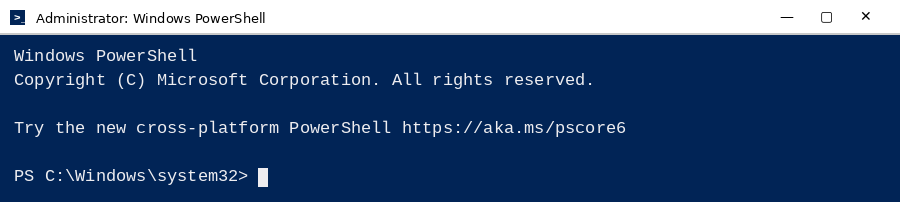

**Working paths used in this lab**

| Item | Path |
|------|------|
| Important file | `C:\Users\Qwiklab\Documents\important_document` |
| Less important file | `C:\Users\Qwiklab\Documents\not_so_important_document` |
| Public file | `C:\Users\Qwiklab\Documents\public_document` |
| Secret folder | `C:\Users\Qwiklab\Secret\` |
| Music folder | `C:\Users\Qwiklab\Music\` |

## ICACLS Quick Reference

**Basic syntax**

```powershell
ICACLS <path>                              # view permissions
ICACLS <path> /grant "<user or group>:(<permission>)"   # add permission
ICACLS <path> /remove "<user or group>"    # remove all of that user's/group's entries
```

**Common permission flags**

| Flag | Meaning |
|------|---------|
| `F` | Full control |
| `R` | Read |
| `W` | Write |
| `RX` | Read and execute |
| `(I)` | Inherited from the parent folder |
| `(OI)` | Object inherit: applies to files inside the folder |
| `(CI)` | Container inherit: applies to subfolders |
| `(IO)` | Inherit only: applies to children, not the folder itself |

---

## Example 1: Give a user read-only access to a file

**Goal:** User `Kara` should have **read-only** access to `important_document`. She currently has read **and** write.

**Step 1: View current permissions**

```powershell
ICACLS C:\Users\Qwiklab\Documents\important_document
```

Output (Kara has `R,W`):

```text
C:\Users\Qwiklab\Documents\important_document QWIKLABS-BB-5A8\Kara:(R,W)
                                              NT AUTHORITY\SYSTEM:(I)(F)
                                              BUILTIN\Administrators:(I)(F)
                                              BUILTIN\Users:(I)(RX)
                                              Everyone:(I)(RX)
```

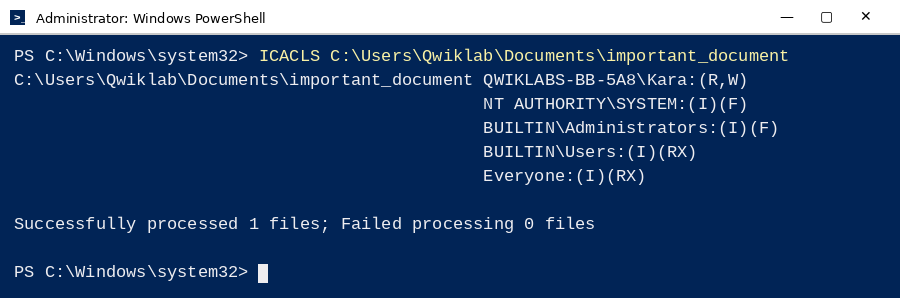

**Step 2: Remove Kara's existing permissions**

```powershell
ICACLS C:\Users\Qwiklab\Documents\important_document /remove "Kara"
```

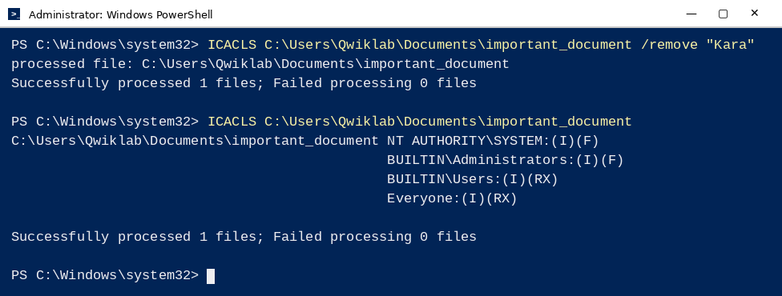

**Step 3: Grant read-only**

```powershell
ICACLS C:\Users\Qwiklab\Documents\important_document /grant "Kara:(r)"
```

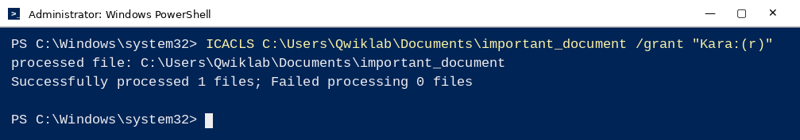

**Step 4: Verify**

```powershell
ICACLS C:\Users\Qwiklab\Documents\important_document
```

```text
C:\Users\Qwiklab\Documents\important_document QWIKLABS-BB-066\Kara:(R)
                                              NT AUTHORITY\SYSTEM:(I)(F)
                                              BUILTIN\Administrators:(I)(F)
                                              BUILTIN\Users:(I)(RX)
                                              Everyone:(I)(RX)
```

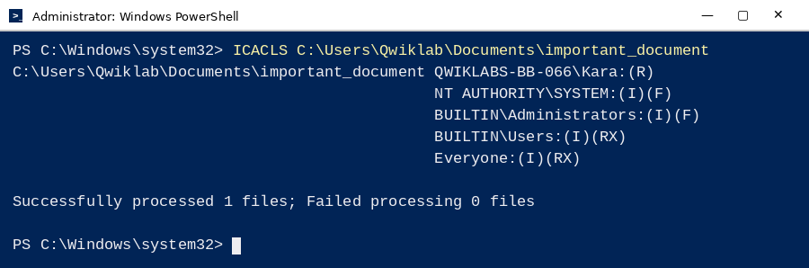

**Result:** Kara now has read-only access.

---

## Example 2: Set different permissions for two users on a folder

**Goal:** On `C:\Users\Qwiklab\Secret\`, give `Phoebe` read access and upgrade `Kara` from read to **read + write**.

**Step 1: View current permissions** (Kara has `R`, Phoebe is not listed)

```powershell
ICACLS C:\Users\Qwiklab\Secret\
```

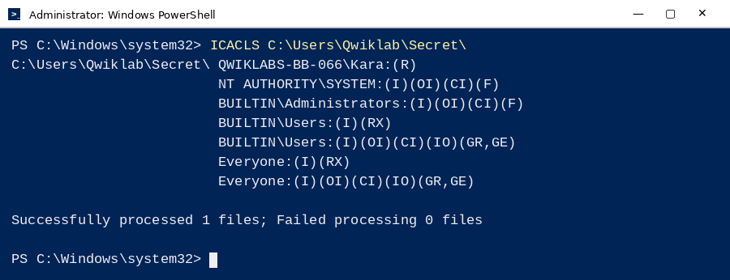

**Step 2: Grant Phoebe read access**

```powershell
ICACLS C:\Users\Qwiklab\Secret\ /grant "Phoebe:(r)"
```

**Step 3: Verify Phoebe was added**

```powershell
ICACLS C:\Users\Qwiklab\Secret\
```

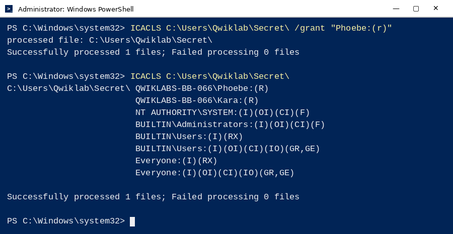

**Step 4: Add write permission for Kara**

`/grant` adds to existing permissions, so there is no need to remove Kara's read permission first.

```powershell
ICACLS C:\Users\Qwiklab\Secret\ /grant "Kara:(w)"
```

**Step 5: Verify**

```powershell
ICACLS C:\Users\Qwiklab\Secret\
```

```text
C:\Users\Qwiklab\Secret\ QWIKLABS-BB-066\Phoebe:(R)
                         QWIKLABS-BB-066\Kara:(R,W)
                         NT AUTHORITY\SYSTEM:(I)(OI)(CI)(F)
                         BUILTIN\Administrators:(I)(OI)(CI)(F)
                         BUILTIN\Users:(I)(RX)
                         BUILTIN\Users:(I)(OI)(CI)(IO)(GR,GE)
                         Everyone:(I)(RX)
                         Everyone:(I)(OI)(CI)(IO)(GR,GE)
```

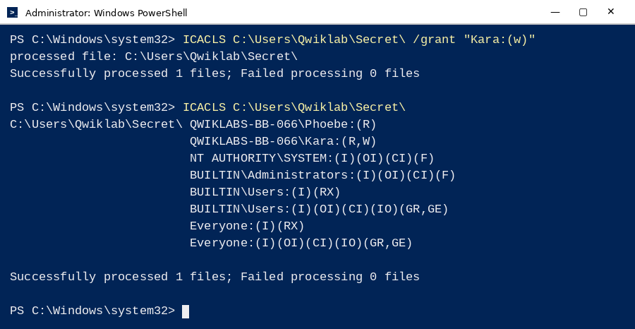

**Result:** Phoebe has `R`, Kara has `R,W`.

---

## Example 3: Restrict a group on a folder

**Goal:** On `C:\Users\Qwiklab\Music\`, the **Everyone** group has read + write. Change it to **read-only**.

> User groups are sets of users managed together. Changing a group's permissions changes access for every member at once. `Everyone` is created by default and every new user is added automatically.

**Step 1: View current permissions**

```powershell
ICACLS C:\Users\Qwiklab\Music\
```

```text
C:\Users\Qwiklab\Music\ Everyone:(R,W)
                        NT AUTHORITY\SYSTEM:(I)(OI)(CI)(F)
                        BUILTIN\Administrators:(I)(OI)(CI)(F)
                        BUILTIN\Users:(I)(RX)
                        BUILTIN\Users:(I)(OI)(CI)(IO)(GR,GE)
                        Everyone:(I)(RX)
                        Everyone:(I)(OI)(CI)(IO)(GR,GE)
```


**Step 2: Remove the group's current permissions**

```powershell
ICACLS C:\Users\Qwiklab\Music\ /remove "Everyone"
```

**Step 3: Grant read-only**

```powershell
ICACLS C:\Users\Qwiklab\Music\ /grant "Everyone:(r)"
```

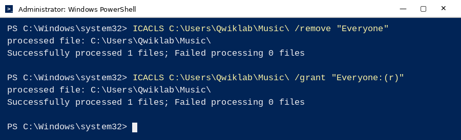

**Step 4: Verify**

```powershell
ICACLS C:\Users\Qwiklab\Music\
```

```text
C:\Users\Qwiklab\Music\ Everyone:(R)
                        NT AUTHORITY\SYSTEM:(I)(OI)(CI)(F)
                        BUILTIN\Administrators:(I)(OI)(CI)(F)
                        BUILTIN\Users:(I)(RX)
                        BUILTIN\Users:(I)(OI)(CI)(IO)(GR,GE)
                        Everyone:(I)(RX)
                        Everyone:(I)(OI)(CI)(IO)(GR,GE)
```

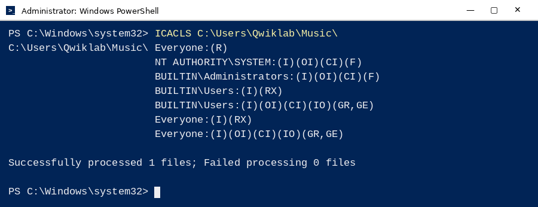

**Result:** `Everyone` now has read-only access.

---

## Example 4: Grant write access to the Authenticated Users group

**Goal:** Give the **Authenticated Users** group write access to `not_so_important_document`. This group contains users who have authenticated to the domain (or a trusted domain).

**Step 1: View current permissions** (the group is not listed)

```powershell
ICACLS C:\Users\Qwiklab\Documents\not_so_important_document
```

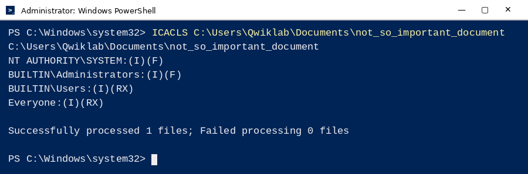

**Step 2: Grant write**

```powershell
ICACLS C:\Users\Qwiklab\Documents\not_so_important_document /grant "Authenticated Users:(w)"
```

**Step 3: Verify**

```powershell
ICACLS C:\Users\Qwiklab\Documents\not_so_important_document
```

```text
C:\Users\Qwiklab\Documents\not_so_important_document
NT AUTHORITY\Authenticated Users:(W)
NT AUTHORITY\SYSTEM:(I)(F)
BUILTIN\Administrators:(I)(F)
BUILTIN\Users:(I)(RX)
Everyone:(I)(RX)
```

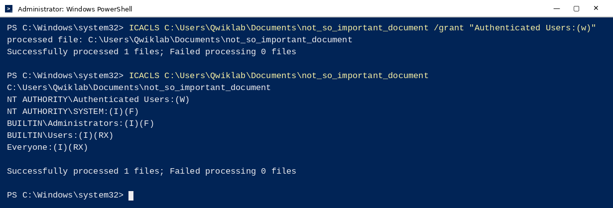

**Result:** Authenticated Users have write access.

---

## Example 5: Make a file publicly readable

**Goal:** Make `public_document` readable by everyone on the system.

Granting the permission to the **Everyone** group is better than adding users one by one: it saves time, and it automatically covers any user created in the future.

**Step 1: View current permissions**

```powershell
ICACLS C:\Users\Qwiklab\Documents\public_document
```

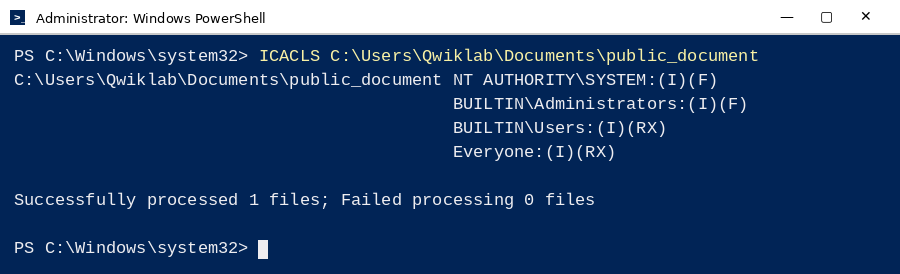

**Step 2: Grant read to Everyone**

```powershell
ICACLS C:\Users\Qwiklab\Documents\public_document /grant "Everyone:(r)"
```

**Step 3: Verify**

```powershell
ICACLS C:\Users\Qwiklab\Documents\public_document
```

```text
C:\Users\Qwiklab\Documents\public_document Everyone:(R)
                                           NT AUTHORITY\SYSTEM:(I)(F)
                                           BUILTIN\Administrators:(I)(F)
                                           BUILTIN\Users:(I)(RX)
                                           Everyone:(I)(RX)
```

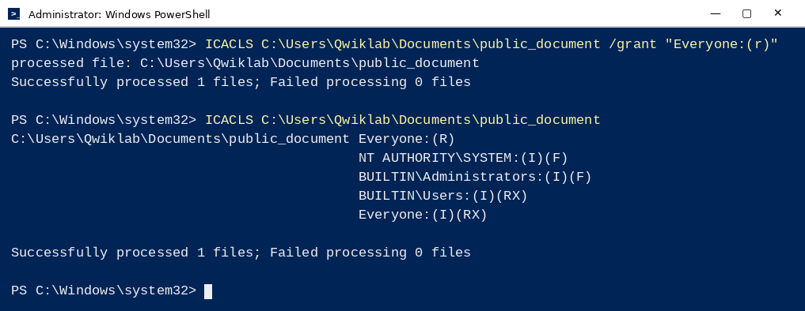

**Result:** Any user on the system can read `public_document`.

---

## Key Takeaways

- **Always view before and after.** Run `ICACLS <path>` first to see the starting point, and again to confirm the change.
- **`/grant` adds; `/remove` deletes.** To *reduce* access (for example, `R,W` to `R`), remove the entry first, then grant only what is needed.
- **Principle of least privilege.** Give users and groups only the access they need, nothing more.
- **Use groups for scale.** Changing a group's permissions updates every member at once and keeps access management consistent.
- **Inheritance matters.** Flags like `(I)`, `(OI)`, and `(CI)` show where a permission comes from and what it applies to.
- **Administrator rights are required** to modify permissions.

*Lab completed as part of the Google Cybersecurity Professional Certificate (Qwiklabs Windows VM).*
