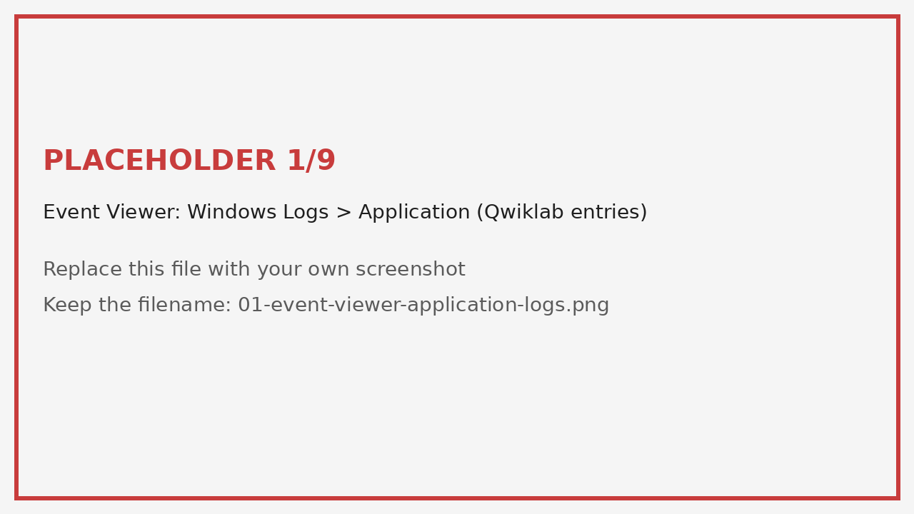
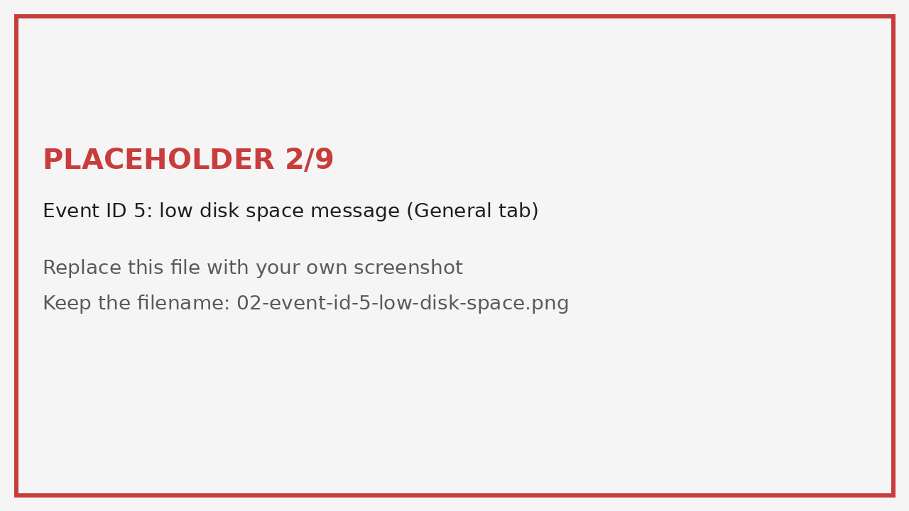
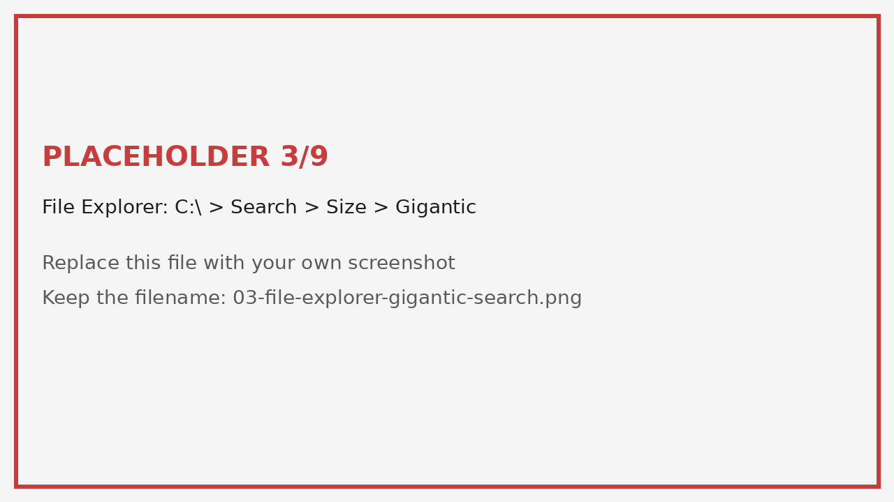
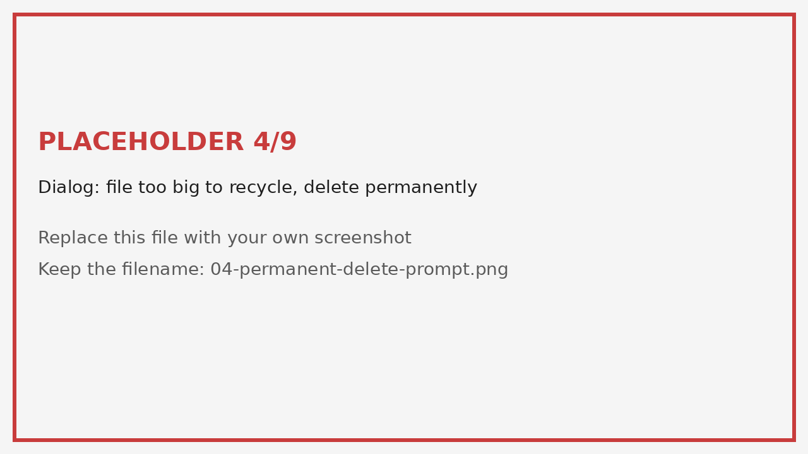
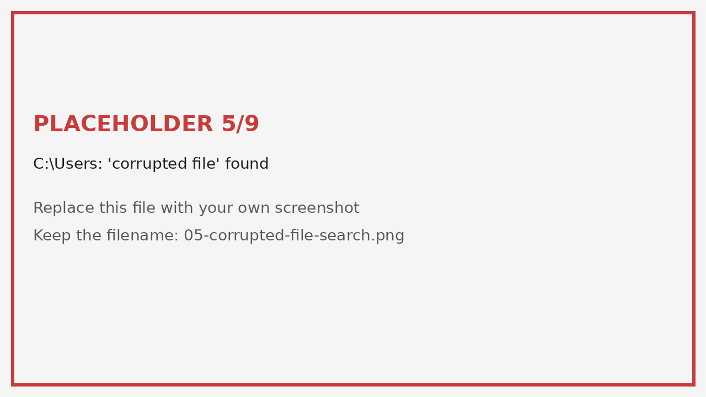
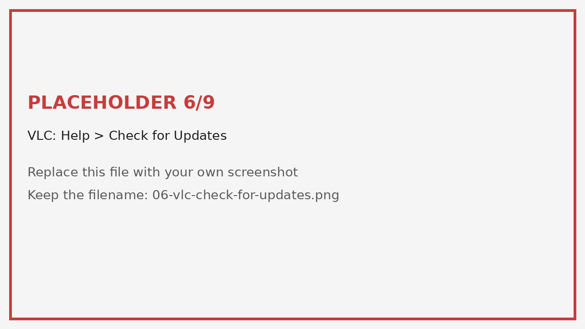
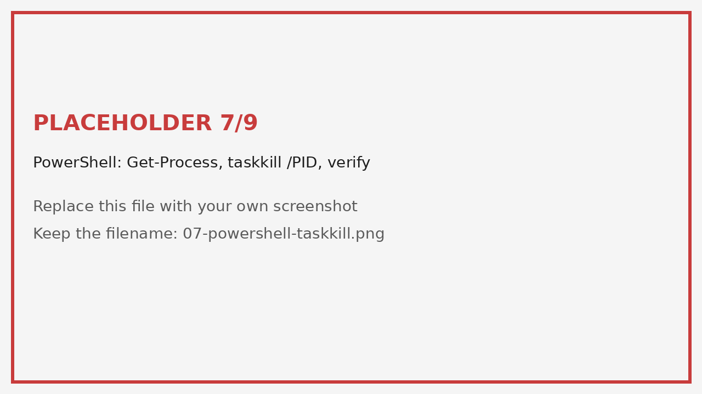
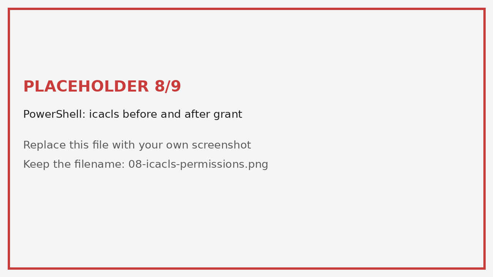
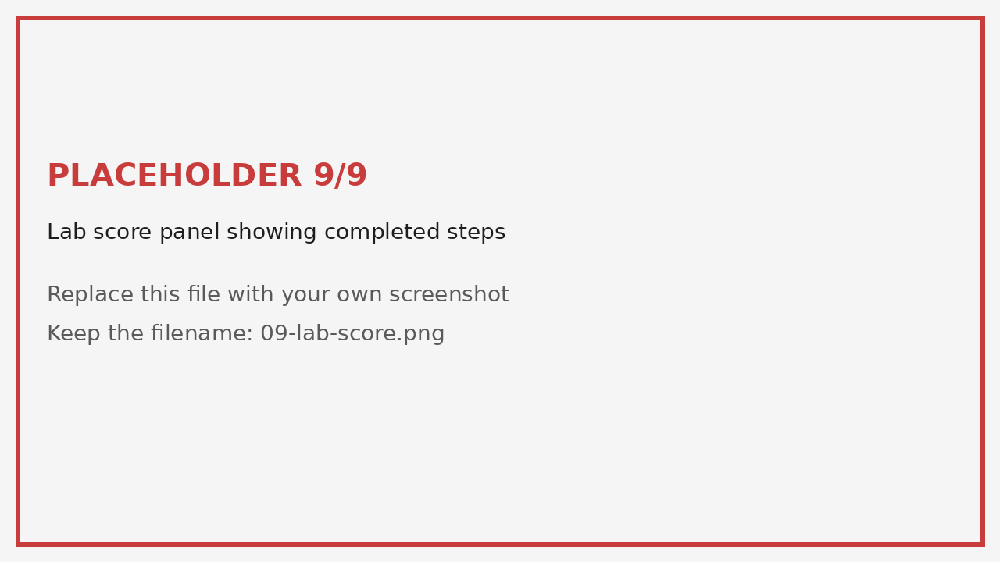

# Troubleshooting Windows Issues Using Event Viewer Logs

**Role focus:** IT Support / Cybersecurity
**Environment:** Windows VM (Event Viewer, File Explorer, PowerShell)
**Skills shown:** Log analysis, root-cause tracing, file management, permissions, software patching, process control

---

## Repository Structure

```
windows-log-troubleshooting-lab/
├── README.md
└── screenshots/
    ├── 01-event-viewer-application-logs.png
    ├── 02-event-id-5-low-disk-space.png
    ├── 03-file-explorer-gigantic-search.png
    ├── 04-permanent-delete-prompt.png
    ├── 05-corrupted-file-search.png
    ├── 06-vlc-check-for-updates.png
    ├── 07-powershell-taskkill.png
    ├── 08-icacls-permissions.png
    └── 09-lab-score.png
```

---

## 1. Overview

A Windows machine was misbehaving with no obvious cause. Instead of guessing, I used **Event Viewer** to read the Application logs, identified five separate problems, and fixed each one with the right Windows tool. The goal was to practice the core support workflow: **read the log, find the cause, fix it, verify it.**

| # | Symptom (from log) | Root cause | Fix |
|---|---|---|---|
| 1 | Disk space critically low (Event ID 5) | One huge file (~10 GB) | Located by size, permanently deleted |
| 2 | Corrupted file reported | Damaged file in the Users directory | Located and deleted |
| 3 | Outdated software | VLC Media Player out of date | Updated to the latest version |
| 4 | Suspicious process running | Process named `totally_not_malicious` | Found PID, terminated with `taskkill` |
| 5 | Access problem on a file | `super_secret_file.txt` lacked write permission | Granted write access with `icacls` |

---

## 2. Method: Finding the Logs

1. Open **Event Viewer** (`Win + R` → `eventvwr.msc`).
2. Go to **Windows Logs → Application**.
3. Look for entries with **Source = Qwiklab** and timestamps near the start of the session.
4. Click each entry and read the **General** tab for the message.



Optional PowerShell way to filter the same logs:

```powershell
Get-WinEvent -FilterHashtable @{LogName='Application'; ProviderName='Qwiklab'} |
  Select-Object TimeCreated, Id, Message | Format-List
```

> Note: logs stay in Event Viewer even after the issue is fixed. They are a record, not a live status.

---

## 3. Issue 1: Low Disk Space (Event ID 5)

**Log message:** disk space is very low.
The log did not name the file, so I had to find it myself.



**Steps (GUI):**
1. Open **File Explorer** → `C:\`.
2. Click the search bar → **Search** tab → **Size → Gigantic (over 4 GB)**.
3. Identify the largest file (~10 GB).



4. Delete it. Because it is too large for the Recycle Bin, Windows asks to permanently delete it. Confirm.



**PowerShell equivalent:**

```powershell
Get-ChildItem C:\ -Recurse -File -ErrorAction SilentlyContinue |
  Where-Object { $_.Length -gt 4GB } |
  Sort-Object Length -Descending |
  Select-Object FullName, @{n='SizeGB';e={[math]::Round($_.Length/1GB,2)}}
```

**Result:** Free space restored.

---

## 4. Issue 2: Corrupted File

**Steps:**
1. Open **File Explorer** and go to `C:\Users`.
2. Search for the file named `corrupted file`.
3. Delete it.



```powershell
Get-ChildItem C:\Users -Recurse -Filter "corrupted*" -ErrorAction SilentlyContinue
Remove-Item "<full path from above>"
```

**Result:** File removed, check passed.

---

## 5. Issue 3: Outdated Software (VLC)

Outdated software is a security risk because known vulnerabilities stay open.

**Steps:**
1. Open **VLC Media Player**.
2. **Help → Check for Updates**.
3. Download and install the update.



**Result:** VLC updated to the current version.

---

## 6. Issue 4: Suspicious Process

**Steps (PowerShell):**

```powershell
# 1. Find the process and its PID
Get-Process totally_not_malicious

# 2. Terminate it
taskkill /PID <PID> /F

# 3. Verify it is gone (should return an error: process not found)
Get-Process totally_not_malicious
```



**Result:** Process terminated. The second lookup failed with "cannot find a process", which confirms it is no longer running.

---

## 7. Issue 5: File Permissions

**Goal:** Give **Everyone** write permission on `super_secret_file.txt` in `C:\Users\Temp`.

```powershell
cd C:\Users\Temp

# View current permissions
icacls .\super_secret_file.txt

# Grant write to Everyone
icacls .\super_secret_file.txt /grant Everyone:W

# Verify
icacls .\super_secret_file.txt
```



**Result:** Permissions updated and verified.

> Security note: in a real environment, granting Everyone write access is usually bad practice. Follow least privilege and grant access only to the users or groups that need it.

---

## 8. Verification

Each fix was checked using the lab's step-by-step scoring.



---

## 9. Key Takeaways

- Logs tell you *what* is wrong; you still need to investigate *where* and *why*.
- Always **verify** after a fix (search again, re-run `icacls`, re-query the process).
- The same approach works for helpdesk tickets and early SOC triage: read the evidence, find the cause, act, confirm.
- Real-world parallel: low disk space, unpatched software, rogue processes, and bad permissions are all common causes of incidents.

---

## 10. Tools Used

`Event Viewer` · `File Explorer` · `PowerShell` · `taskkill` · `icacls` · `VLC`

---

*Lab environment: Windows VM provided through a Coursera / Google IT Support course lab. This write-up is my own documentation of the steps I performed.*
