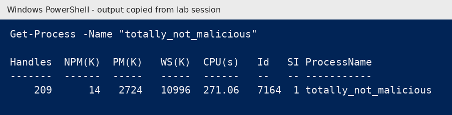
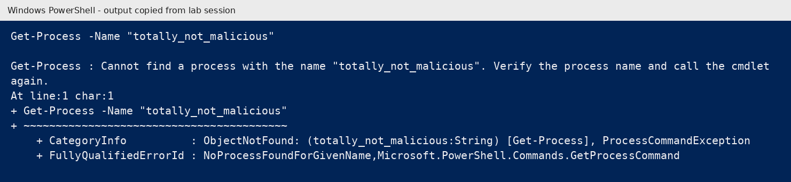
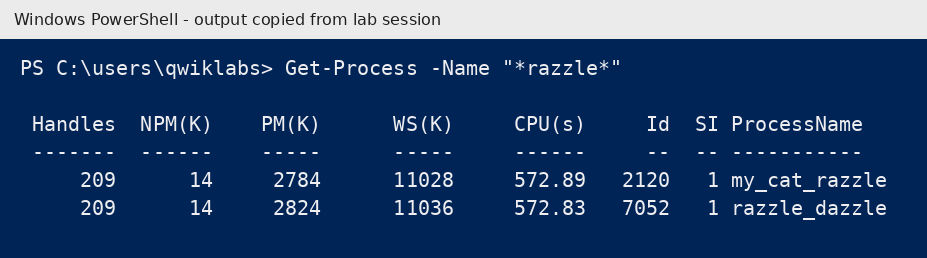
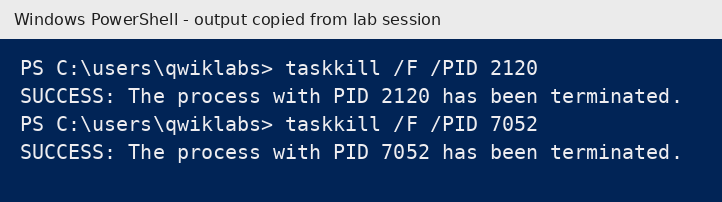
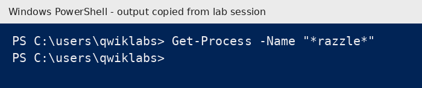

# Maintain Efficient Process Utilization on Windows

Write-up of the hands-on lab *"Maintain efficient process utilization on Windows"* (Google IT Support course, Coursera). It covers finding, inspecting, and terminating processes that waste CPU or memory, using PowerShell.

> **About the images:** the images below are PowerShell output windows rendered from the text I copied during my lab session. The commands and results are exactly as they appeared in the lab.

---

## Repository Structure

```
windows-process-management/
├── README.md
└── screenshots/
    ├── 02-get-process-totally-not-malicious.png
    ├── 03-verify-process-gone.png
    ├── 04-get-process-razzle-wildcard.png
    ├── 05-taskkill-razzle-processes.png
    └── 06-verify-razzle-gone.png
```

---

## 1. Why This Matters

Every running program is a **process** that uses CPU, memory, and disk. A runaway or unwanted process slows the machine and can also be a security problem (malware, crypto miners, leftover tools). Support staff need to find the process, confirm what it is, end it safely, and check that it is gone.

**Workflow:** identify, inspect, terminate, verify.

## 2. Tools Used

| Tool | Purpose |
|---|---|
| PowerShell `Get-Process` | List processes, find the PID, see resource use |
| `taskkill` | Terminate a process by PID |

---

## 3. Task A: Find and Stop a Single Process

**Scenario:** a process named `totally_not_malicious` was running.

### Step 1: Find the process and its PID
```powershell
Get-Process -Name "totally_not_malicious"
```

*Figure 1: the process is running with PID 7164 and 271 seconds of CPU time.*

### Step 2: Terminate it by PID
```powershell
taskkill /F /PID <PID>
```
`/F` forces termination and `/PID` selects the process by its ID, taken from Step 1.

### Step 3: Verify it is gone
```powershell
Get-Process -Name "totally_not_malicious"
```

*Figure 2: the "Cannot find a process" error is the expected result and confirms the process no longer exists.*

---

## 4. Task B: Find and Stop Multiple Related Processes

**Scenario:** several processes shared a keyword and the exact names were not known. A **wildcard** (`*`) search finds them all.

### Step 1: Wildcard search
```powershell
Get-Process -Name "*razzle*"
```

*Figure 3: two matching processes, `my_cat_razzle` (PID 2120) and `razzle_dazzle` (PID 7052).*

### Step 2: Terminate each one
```powershell
taskkill /F /PID 2120
taskkill /F /PID 7052
```

*Figure 4: both processes terminated successfully.*

### Step 3: Verify
```powershell
Get-Process -Name "*razzle*"
```

*Figure 5: an empty result means no matching process remains.*

---

## 5. Key Takeaways

- Always read the **PID from the process list**. PIDs change every session, so never reuse an old one.
- Use a **wildcard** when you only know part of a name.
- **Verify** after terminating. An empty result or "cannot find a process" means success.
- In a real incident, check *what* a process is (path, parent, network activity) before killing it, because it may be evidence or a critical service.

## 6. Skills Demonstrated

Windows process management · PowerShell · `Get-Process` · `taskkill` · wildcard searching · troubleshooting workflow · verification

**Credential link:** `<add your Coursera certificate or profile URL here>`
