# Windows Services Management with GUI and PowerShell

Hands-on lab (Google Cloud Skills Boost / Qwiklabs) on managing Windows services using both the **Services GUI** and **PowerShell**, then installing and configuring an **IIS web server**.

> Lab environment: Windows Server VM (disposable). Do not stop services on a personal machine.

## Skills practiced
- Listing, starting, stopping and restarting services (GUI and `Get-Service`, `Start-Service`, `Stop-Service`)
- Reading service properties and the **Recovery** tab
- Enabling a **Disabled** service with `Set-Service -StartupType`
- Installing Windows features with `Install-WindowsFeature`
- Hosting a website with IIS Manager

## Repository structure
```
.
├── README.md
├── scripts/windows-services-lab.ps1   # all commands + security bonus queries
├── outputs/                           # captured PowerShell output
└── screenshots/                       # GUI walkthrough screenshots
```

## Part 1: Services GUI

Open **Services** from the Start menu (or Control Panel > System and Security > Administrative Tools > Services).

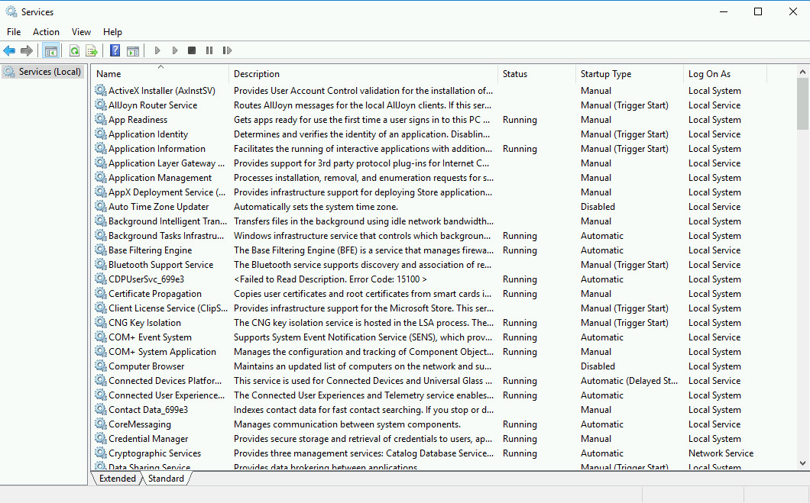

Right-click a service to see the available actions. Unavailable actions are grayed out.

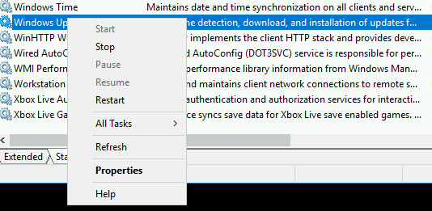

The **Recovery** tab shows what Windows does if a service fails.

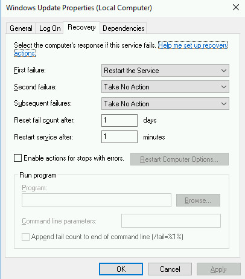

**Stop** the Themes service (safe only because this is a VM):

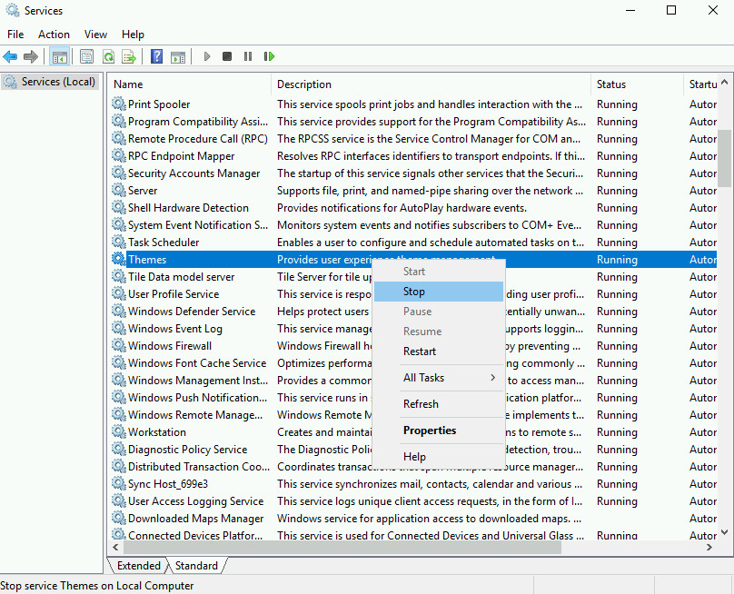

**Start** Performance Logs & Alerts (not running by default):

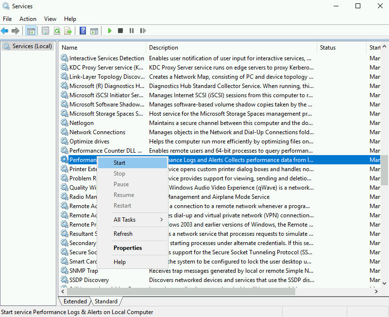

### Enabling a service from another tool
Auto Time Zone Updater is Disabled by default. Turning on *Set time zone automatically* in Date and Time settings enables it.

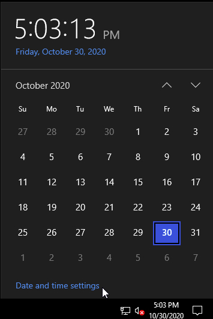
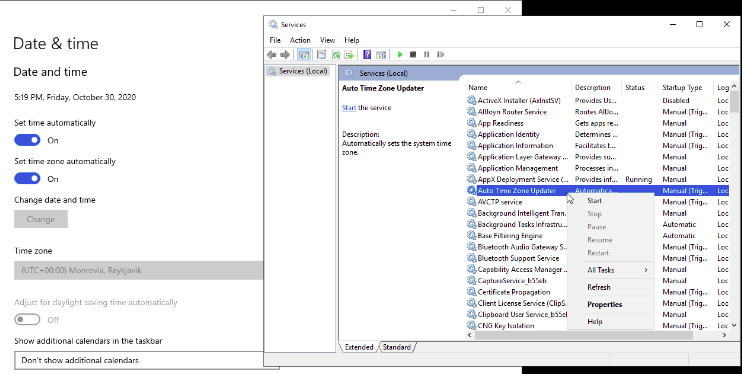

## Part 2: PowerShell

Open Windows PowerShell from the Start menu.

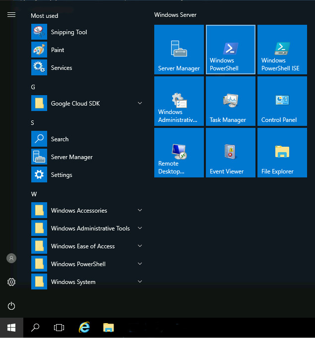

| Task | Command |
|---|---|
| List all services | `Get-Service` |
| One service | `Get-Service wisvc` |
| All properties | `Get-Service wisvc \| Format-List *` |
| Start | `Start-Service wisvc` |
| Stop | `Stop-Service wisvc` |
| Enable a disabled service | `Set-Service ScardSvr -StartupType Manual` |
| Install a feature | `Install-WindowsFeature Web-WebServer,Web-Mgmt-Tools -IncludeAllSubFeature` |

### Output: list services
```powershell
Get-Service
```
See [`outputs/01-get-service.txt`](outputs/01-get-service.txt).

### Output: inspect one service
```powershell
Get-Service wisvc
```
```
Status   Name               DisplayName
------   ----               -----------
Stopped  wisvc              Windows Insider Service
```

```powershell
Get-Service wisvc | Format-List *
```
```
Name                : wisvc
RequiredServices    : {rpcss}
DisplayName         : Windows Insider Service
Status              : Stopped
ServiceType         : Win32ShareProcess
StartType           : Manual
```
Full output: [`outputs/03-format-list-wisvc.txt`](outputs/03-format-list-wisvc.txt)

### Output: starting a Disabled service fails
```powershell
Get-Service ScardSvr | Format-List *   # StartType : Disabled
Start-Service ScardSvr
```
```
Start-Service : Service 'Smart Card (ScardSvr)' cannot be started due to the
following error: Cannot start service ScardSvr on computer '.'.
    + FullyQualifiedErrorId : CouldNotStartService,Microsoft.PowerShell.Commands.StartServiceCommand
```
Full output: [`outputs/05-start-disabled-service-error.txt`](outputs/05-start-disabled-service-error.txt)

### Fix: change StartType, then start
```powershell
Set-Service ScardSvr -StartupType Manual
Start-Service ScardSvr
Get-Service ScardSvr
```
```
Status   Name               DisplayName
------   ----               -----------
Running  ScardSvr           Smart Card
```

## Part 3: IIS web server

```powershell
Install-WindowsFeature Web-WebServer,Web-Mgmt-Tools -IncludeAllSubFeature
Get-Service IISADMIN
```
```
Success Restart Needed Exit Code      Feature Result
------- -------------- ---------      --------------
True    No             Success        {.NET Framework 3.5 (includes .NET 2.0 and...

Status   Name               DisplayName
------   ----               -----------
Running  IISADMIN           IIS Admin Service
```

Open IIS Manager:

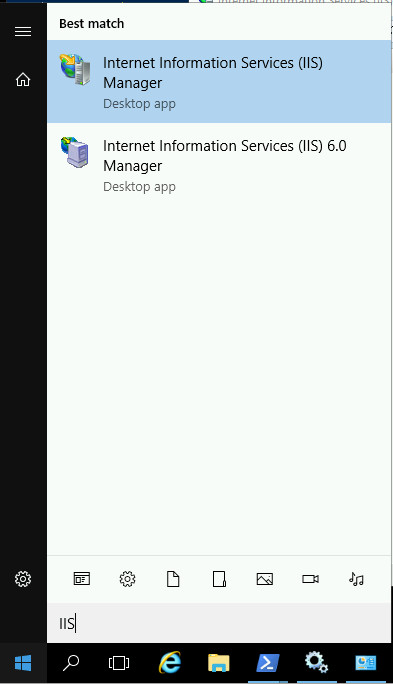

Sites > right-click > **Add Website...**:

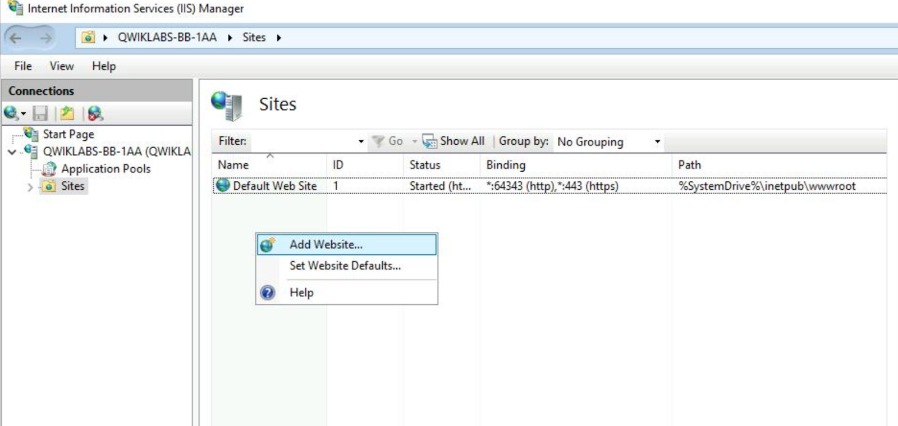

Set the site name, physical path (`C:\Users\qwiklabs\amazingsite`) and port 80:

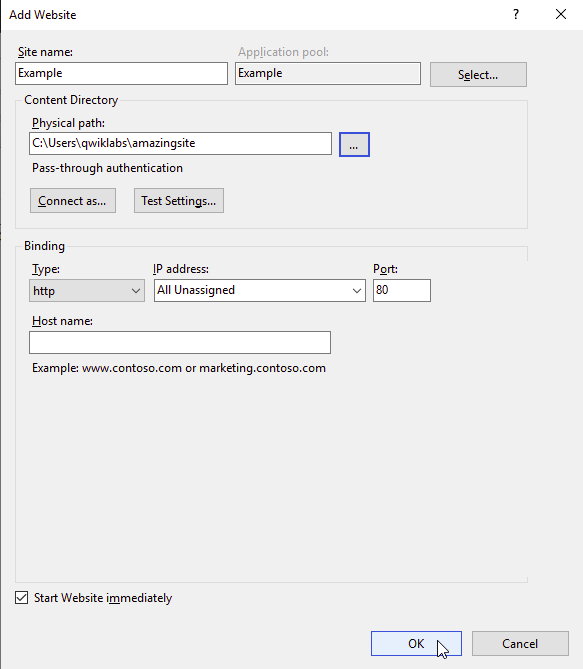

After clicking OK, the site runs on port 80. Opening the VM's External IP in a browser shows the new website:


## Security notes (blue team view)
- **Attack surface:** services that are not needed should stay Disabled. Enabling them (like Smart Card) increases exposure.
- **Persistence:** attackers may create new services or change a service StartType. Knowing `Get-Service` / `Set-Service` helps in spotting this.
- **Detection:** System log Event ID **7045** (new service installed) and **7040** (start type changed). Queries are in the script.

## Disclaimer
Educational lab notes. Run only in a disposable lab VM.
